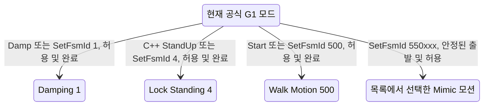
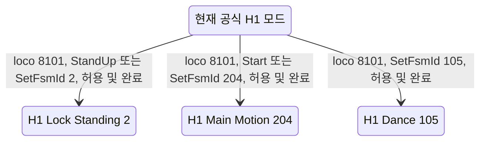
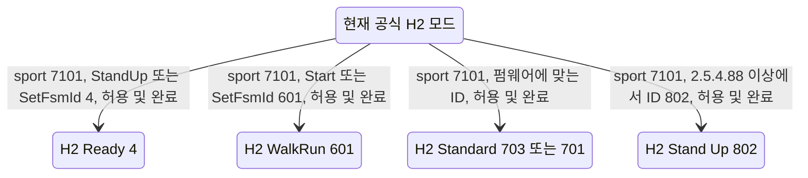
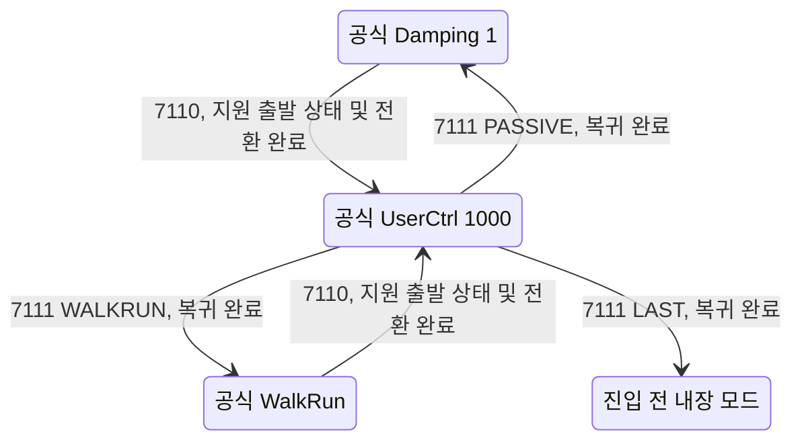
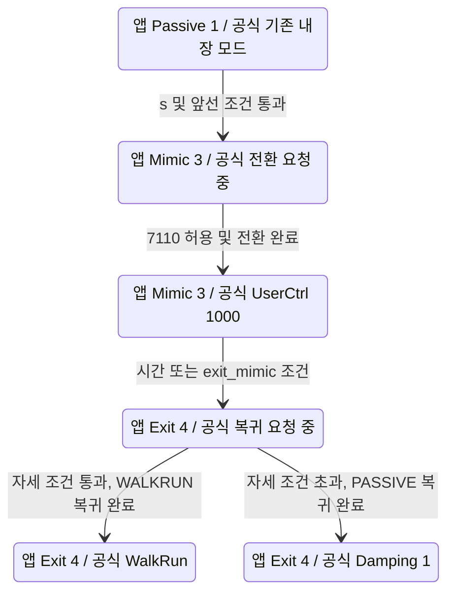

# FsmId 통합 참조: G1·H1·H2와 UniStore 앱의 등록·전환

[문서 색인](README.md) · [G1 개념 상세](g1-control-concepts.ko.md) · [앱 실행 상세](g1-mimic-runtime.ko.md)

기준일: **2026-11-18, Asia/Seoul**.
이 문서는 앞선 조사의 통합 참조본이다. 공식 문서에 공개된 모드, SDK가 실제 전송하는 요청,
템플릿의 전이 조건 및 자료 사이의 차이를 함께 기록한다.
비공개 펌웨어의 모든 상태·보호 조건을 복원한 전체 전이표라고 주장하지 않는다.

## 1. 먼저 적용할 결론

1. **FsmId는 모델별 공식 운동 제어기의 모드 번호이다.** 같은 숫자의 의미와 RPC 번호가 모델마다 다르다.
2. **G1 `550xxx`는 모션 선택용 복합 호출값이다.** 접미사는 `motion_api_id`이며 UniStore Action ID와 구분한다.
3. **G1 UserCtrl `1000`은 외부 프로그램의 전신 제어권을 위한 기존 공식 모드이다.** 앱마다 새로 발급받는 번호가 아니다.
4. **현재 g1_mimic_demo의 상태 추가는 프로세스 내부 등록이다.** `REGISTER_FSM`·YAML의 ID를 공식 제어기에 등록하는 RPC는 없다.
5. **이 템플릿의 배포는 앱 패키지·런타임을 추가하는 방식이다.** 공개 설치 계약에는 앱마다 새 공식 FsmId를 발급하는 단계가 없다.
6. **요청값, RPC 성공, 보고 상태, 실제 제어 적용은 구분한다.** 전이 조건과 완료 여부를 각 단계에서 확인해야 한다.

현재 템플릿의 실행을 가장 간단히 표현하면 다음과 같다.

```text
설치된 앱을 플랫폼의 실행 경로로 시작
→ HTTP Start
→ 앱 내부 Mimic=3
→ SwitchToUserCtrl 요청
→ 전환 성공 시 공식 UserCtrl=1000
→ 앱 정책이 rt/user_lowcmd 발행
→ 앱 종료 조건
→ SwitchToInternalCtrl로 내장 모드 복귀 요청
```

이 경로에 `SetFsmId(550 + 앱 번호)`를 넣거나, 설치 후 앱마다 `1001`, `1002` 등을
배정한다고 설명하면 현재 공개 계약·소스와 맞지 않는다.
예를 들어 G1 공식 문서의 `1001`은 이미 Adaptive Stand-up으로 정의되어 있다.

## 2. 자료 기준과 서로 다른 번호 체계

### 2.1 분석한 버전

| 항목 | 기준 |
|---|---|
| 공식 C++ SDK 원격 main | `aaf69cb56c9d5ed63d8b284008ec3a8ab999bec1` |
| 로컬 C++ SDK | `63096d0ac0c5d2dec9d6e0c22cd5233410ca2f36` |
| Python SDK | `814556d15970dd2ecf1c9984e845ca02ab07e206` |
| 복원 SDK / lgrobot_sdk | `392e753457adb24d08c2c1efd09cc2112d29a953` |
| 앱 실행 소스 기준 | `1a16513b8a57d76708ffd2854fe2a73c090cced1` |

G1에 이어 H1·H2의 Loco 클라이언트와 API 헤더도 원격 커밋에서 읽어 로컬 SDK와 대조했다.
해당 H1·H2 네 파일의 내용도 동일했다.
공식 문서의 정확한 URL은 모델별 표 아래에 연결했다.
H1 문서는 `Sports_Services_Interface`라는 대소문자 구분 경로를 사용한다.
빈 메뉴 화면이 반환된 추정 URL은 근거로 사용하지 않았다.
수집한 원문의 URL·내용 해시와 SDK 파일별 대조 기준은
[자료 색인](evidence/fsm-source-index.json)에 기록했다.

### 2.2 번호의 소속

| 구분 | 정의·예 | 관리 주체 |
|---|---|---|
| 공식 FsmId | G1 UserCtrl 1000, H1 주 운용 204, H2 주 운용 601 | 로봇의 모델별 운동 제어기 |
| FsmMode | 문서의 정적 0 / 동적 1 등 | 선택된 공식 모드의 상태 보고 |
| RPC API 번호 | G1 SetFsmId의 7101, H1 SetFsmId의 8101 | 서비스 프로토콜 |
| G1 모션 API ID | `GetMimicMotion()`의 `motion` 키 | 공식 Mimic 모션 목록 |
| G1 복합 모션 호출값 | `550507` | SetFsmId에 전달하는 모션 선택값 |
| UniStore Action ID | 공식 생성 폼의 문자열 식별자 | 플랫폼의 앱 리소스 |
| 앱 내부 상태 ID | Passive 1, Velocity 2, Mimic 3, Exit 4 | 앱 프로세스의 CtrlFSM |
| Python 옵션 ID | Start를 선택하는 1 | 앱 HTTP 서버 |
| InternalFsmMode | LAST 0, PASSIVE 1, WALKRUN 2 | G1 복귀 API의 인자 |
| mode_machine | 특정 하드웨어 구성의 5 등 | 저수준 메시지의 기체 구성 식별 |

리모컨 설명의 동그라미 ①·②·③ 같은 절차 번호도 공식 FsmId가 아니다.
H2의 설명에서 ②는 Locked Standing 절차를 가리키지만, 공식 표의 그 모드 ID는 4이다.

`FsmMode`의 0·1은 공식 문서가 설명한 값이며 모든 실제 값의 완전한 열거형은 아니다.
G1 Arm Action 오류 헤더는 일부 동작의 허용 조건에 `fsm_mode={0,3}`을 기재하지만
3의 의미를 정의하지 않는다. 이를 임의로 정적·동적 상태 중 하나에 배정하지 않는다.
원문과 `rt/arm_sdk` 조건의 구분은 [개념 문서 3·8절](g1-control-concepts.ko.md)에 있다.

## 3. 모델별 서비스와 상태 선택 함수

### 3.1 RPC를 보낼 서비스부터 다르다

| 항목 | G1 | H1 | H2 |
|---|---|---|---|
| C++ 클래스 | `g1::LocoClient` | `h1::LocoClient` | `h2::LocoClient` |
| 서비스 이름 | `sport` | `loco` | `sport` |
| API 버전 | `1.0.0.0` | `2.0.0.0` | `1.0.0.0` |
| GetFsmId | 7001 | 8001 | 7001 |
| GetFsmMode | 7002 | 8002 | 7002 |
| SetFsmId | 7101 | 8101 | 7101 |
| SetBalanceMode | 7102 | 8102 | 7102 |
| SetVelocity | 7105 | 8105 | 7105 |
| GetMimicMotion | 7100, JSON의 550/1 지정 | 해당 메서드 없음 | 해당 메서드 없음 |
| SwitchToUserCtrl / InternalCtrl | 7110 / 7111 | 해당 메서드 없음 | 해당 메서드 없음 |
| GetAvailableFsmIds | 해당 메서드 없음 | 해당 메서드 없음 | 7008 |

“해당 메서드 없음”은 위 SDK 클래스의 공개 인터페이스에 대한 확인이다.
그 모델의 모든 비공개 펌웨어 기능이 없다는 주장으로 확장하지 않는다.
동일한 `sport` 이름이나 일부 API 번호가 같아도 G1 요청을 H2에 그대로 적용하지 않는다.

### 3.2 C++ 편의 함수가 요청하는 FsmId

| 함수 | G1 요청값 | H1 요청값 | H2 요청값 |
|---|---:|---:|---:|
| `ZeroTorque()` | 0 | 0 | 0 |
| `Damp()` | 1 | 1 | 1 |
| `StandUp()` | 4 | 2 | 4 |
| `Start()` | 500 | 204 | 601 |
| `Squat()` | 2 | 없음 | 2 |
| `Sit()` | 3 | 없음 | 3 |

이 표는 **SDK 함수 본문의 전송값**이다. 표에 숫자가 있다고 대상 펌웨어가 반드시
그 ID를 수용한다는 뜻은 아니다. 특히 H2의 2·3은 아래 공식 모드 표에 등재되어 있지 않다.
모드 변경 성공을 확인하지 않고 편의 함수 이름만으로 물리적 동작을 판단하지 않는다.

근거: [G1 클라이언트][g1-client], [H1 클라이언트][h1-client], [H2 클라이언트][h2-client],
[G1 API][g1-api], [H1 API][h1-api], [H2 API][h2-api].

## 4. G1 FsmId 참조표

| ID·호출값 | 공식 문서상 의미 | 선택·전환 요청 | 조건·해석 |
|---|---|---|---|
| 0 | Zero Torque | `ZeroTorque()` / `SetFsmId(0)` | 균형 제어 없음 |
| 1 | Damping | `Damp()` / `SetFsmId(1)` | 균형 제어 없음. 자동 UserCtrl 진입은 아님 |
| 2 | Position Control Squat | C++ `Squat()` / `SetFsmId(2)` | 균형 제어 없는 위치 제어 자세 |
| 3 | Position Control Sit Down | `Sit()` / `SetFsmId(3)` | 균형 제어 없음 |
| 4 | Lock Standing | C++ `StandUp()` / `SetFsmId(4)` | 균형 제어 없음 |
| 500 | Walk Motion | `Start()` / `SetFsmId(500)` | 일반 운용 제어 |
| 501 | Walk Motion–3DoF-waist | `SetFsmId(501)` | 3자유도 허리 구성 관련 모드 |
| 702 | Lie Down / Stand Up | `SetFsmId(702)` | Python `Lie2StandUp()`도 이 값 사용 |
| 706 | Balance Squat / Squat Stand | `SetFsmId(706)` | Python의 하강·기립 함수들이 이 값 사용 |
| 801 | Run / 보행·주행 운용 | `SetFsmId(801)` | 아래 버전 조건 참고 |
| 802 | 일부 29자유도 구성의 갱신된 보행·주행 운용 ID | 대상 버전의 모드 선택 요청 | 공식 문서: ai_sport 8.6.x.x 이후 801에서 갱신 |
| 1000 | UserCtrl | 전용 `SwitchToUserCtrl()` | 외부 관절 명령 경로는 `rt/user_lowcmd` |
| 1001 | Adaptive Stand-up | `SetFsmId(1001)`이라는 전문가 모드 선택 형식 | 문서에 모드 등재. 앱 설치 번호가 아님 |
| 550 | Mimic 목록 요청의 `fsm_id` 및 모션 접두사 | `GetMimicMotion()`의 JSON 값 | `SetFsmId(550)` 단독 실행 계약과 혼동하지 않음 |
| 550 + 모션 ID | 개별 Mimic 모션 실행 선택 | 예: `SetFsmId(550507)` | 실제 목록에 있는 `motion_api_id` 선택, 안정된 시작 자세 |

이 표의 550 계열은 **모션 선택용 요청값**과 목록 요청 필드를 구분해 표시했다.
모션 실행 중 GetFsmId가 반드시 550xxx를 그대로 보고한다는 대응 계약은 제시하지 않는다.
공식 문서의 기본 모드 표와 SDK의 모션 조회 기능을 모두 포함하되, 임의의 새 ID를 추가하지 않았다.

### 4.1 C++와 Python의 이름 차이

분석한 Python G1 클라이언트는 `Squat2StandUp()`과 `StandUp2Squat()`에서 모두 706을,
`Lie2StandUp()`에서 702를 요청한다.
C++의 `StandUp()` 4와 Python의 이름에 들어 있는 StandUp을 동일한 모드로 취급하면 안 된다.
함수명·언어·버전을 함께 확인한다.

근거: [G1 공식 운동 서비스][g1-doc], [G1 중문 문서][g1-doc-zh],
[공식 SDK G1 클라이언트][g1-client], [분석한 Python G1 클라이언트][g1-python].

## 5. H1 FsmId 참조표

| ID | 공식 문서상 의미 | 선택 함수·요청 |
|---:|---|---|
| 0 | Zero Torque | `ZeroTorque()` / `SetFsmId(0)` |
| 1 | Damping | `Damp()` / `SetFsmId(1)` |
| 2 | Lock Standing | `StandUp()` / `SetFsmId(2)` |
| 105 | Whole Body Coordinated Dance | `SetFsmId(105)` |
| 204 | Main Motion Control | `Start()` / `SetFsmId(204)` |
| 206 | High-speed Motion Control | `SetFsmId(206)` |
| 208 | Upper Limb Movement Adaptation | `SetFsmId(208)` |

H1의 Dance 105에 G1의 550 접두사 규칙을 적용하지 않는다.
H1의 모드 2는 G1의 Squat 2와 의미가 다르다.
상태 선택은 H1의 `loco` 서비스 API 8101로 전달된다.

H1 공식 영문 페이지에는 SetFsmId 행의 prototype을 GetFsmId로 적거나,
중문·SDK에 없는 SetFsmMode 행을 제시한 차이가 있다.
실제 C++ 호출 시그니처와 전송 API는 SDK 및 중문 원문을 대조해 확정했다.
분석한 SDK에는 `SetFsmMode()`가 없다.

또한 H1 C++의 `GetFsmId()`·`GetFsmMode()`는 G1/H2와 달리 `ret==0` 조건 없이
응답 JSON을 파싱한다. G1의 출력 인자 갱신 규칙을 H1까지 일반화하지 않는다.
호출자는 오류·파싱 실패도 고려해야 한다.

근거: [H1 공식 영문 문서][h1-doc], [H1 중문 원문][h1-doc-zh], [H1 SDK][h1-client].

## 6. H2 FsmId 참조표와 런타임 목록

| ID | 공식 문서상 의미 | 적용 범위 |
|---:|---|---|
| 0 | Zero Torque | 균형 제어 없음 |
| 1 | Damping | 균형 제어 없음 |
| 4 | Locked Standing / Ready | 균형 제어 없음 |
| 601 | Walk/Run Locomotion | 운동 제어기가 상체도 제어 |
| 703 | Standard Locomotion | ai_sport < 2.5.4.11, 상체를 운동 제어기가 제어하지 않는 모드 |
| 701 | Standard Locomotion | ai_sport >= 2.5.4.11, 위 일반 운용 모드의 버전별 ID |
| 802 | Stand Up | ai_sport >= 2.5.4.88 |
| 803 | Lie Down | ai_sport >= 2.5.4.88 |

**G1의 802와 H2의 802는 의미가 다르다.**
H2 SDK에 남아 있는 `Squat()->2`, `Sit()->3`은 위 공식 표의 지원 확인과 구분한다.
H2 리모컨 문서의 Dance·Box 모드 이름만 보고 G1의 550 또는 H1의 105를 배정하지 않는다.

### 6.1 GetAvailableFsmIds

H2는 API 7008로 `GetAvailableFsmIds(ids, names)`를 제공한다.
SDK는 응답 JSON의 `ids`, `names` 배열을 같은 인덱스끼리 대응시킨다.
성공 시 기존 출력 벡터를 비우고 대응 항목을 추가한다.
두 배열의 길이가 다르면 C++ 구현은 짧은 쪽까지 처리한다.

이 API는 **서버가 제공하는 목록 조회**이다. 새 ID를 등록하는 메서드가 아니다.
분석한 G1·H1 클라이언트에 동일한 메서드는 없다.
H2 응답 목록도 모든 상태 사이의 전환 허용 표나 UniStore 앱 등록표를 의미하지 않는다.

### 6.2 Arm SDK의 예제 조건과 최신 문서 차이

공식 H2 Arm SDK 예제는 `GetFsmId()` 성공 후 4 또는 703인지 검사하고,
그 후 `EnableArmSDK()`를 호출한다. 이 메서드는 API 7109에 bool을 보내며
FsmId를 바꾸는 `SetFsmId()` 호출은 아니다.

최신 문서는 일반 운용 ID가 버전에 따라 703에서 701로 바뀐다고 설명하지만,
검토한 예제의 조건식은 여전히 `{4,703}`이다.
따라서 예제의 허용 목록을 모든 최신 펌웨어의 전체 지원 목록으로 제시하지 않는다.
H2의 상체 제어 상태 플래그를 G1의 UserCtrl 1000으로 부르는 것도 맞지 않는다.

근거: [H2 공식 문서][h2-doc], [H2 중문 문서][h2-doc-zh],
[H2 SDK][h2-client], [H2 API·목록 파서][h2-api], [H2 Arm SDK 예제][h2-arm-example].

## 7. 어떤 호출과 조건이 전이를 요청하는가

### 7.1 함수별 효과를 구분한다

| 호출·이벤트 | 직접 요청하는 것 | FsmId 전이와의 관계 |
|---|---|---|
| `SetFsmId(n)` | 공식 목표 모드·모션 선택 | 모델별 setter API로 전이 요청 |
| `Damp/Start/StandUp/...` | 각 모델 표의 SetFsmId 호출 | 편의 함수가 같은 전이 요청을 생성 |
| G1 `SwitchToUserCtrl()` | 외부 전신 제어권 인계 | UserCtrl 1000 진입 요청 |
| G1 `SwitchToInternalCtrl(mode)` | 기존 공식 내장 제어로 복귀 | LAST/PASSIVE/WALKRUN 선택값에 따른 복귀 요청 |
| `GetFsmId/GetFsmMode` | 현재 상태 조회 | 조회 자체를 전이 명령으로 사용하지 않음 |
| `GetMimicMotion` | G1 공식 모션 목록 조회 | 조회만으로 춤이나 앱 정책을 시작하지 않음 |
| H2 `GetAvailableFsmIds` | 지원 모드 목록 조회 | ID 등록·전이 아님 |
| `StopMove()` | 속도 0 요청 | Damping이나 공식 FsmId 0을 선택하는 함수가 아님 |
| `Move/SetVelocity` | 속도 목표 | 그 자체를 특정 새 FsmId 선택 함수로 설명하지 않음 |
| `BalanceStand/ContinuousGait` | SetBalanceMode 값 | 주 운용 모드 내부의 동작 설정. 새 FsmId 선택과 구분 |
| `SwitchMoveMode(bool)` | 클라이언트의 지속 이동 설정 | 이 함수 자체에는 RPC가 없음 |
| `WaveHand/ShakeHand/SetTaskId` | 상체 작업 요청 | task_id를 FsmId로 해석하지 않음 |
| H2 `EnableArmSDK/DisableArmSDK` | 상체 제어 상태 bool | API 7109이며 FsmId setter가 아님 |
| 리모컨 모드 버튼 | 펌웨어가 처리하는 모드 전환 입력 | 버전별 설명·모드 허용 조건 적용 |
| `ReleaseMode()` | Motion Switcher를 통한 내장 제어 해제 | 공식 FsmId의 특정 값과 동일시하지 않음 |

`SwitchMoveMode(true)` 이후의 Move는 SDK에서 duration을 864000초로 설정한다.
공식 설명의 지속 이동을 소스상 무한대 시간으로 기록하지 않는다.

### 7.2 전이 요청과 실제 상태 변경의 조건

| 확인 단계 | 공개 근거로 확인할 수 있는 조건 |
|---|---|
| 대상 선택 | 로봇 모델·서비스·SDK가 맞고 대상 ID가 해당 펌웨어에서 지원되어야 함 |
| 공식 제어 서비스 | 기존 Debug Mode로 내장 운동 제어를 해제하면 관련 고수준 서비스는 유효하지 않다는 문서 계약 |
| 현재 자세·동작 | G1 문서는 현재 자세가 전환에 부적합하면 모드 변경을 금지한다고 설명 |
| FsmMode | G1의 Static 0은 외부 모드 전환 가능 상태, Dynamic 1은 대부분 제한. 모든 target의 허용증은 아님 |
| 모션 시작 | G1 Mimic 호출은 기립 등 안정된 출발 상태를 요구 |
| UserCtrl 출발 상태 | 공식 UniStore 매뉴얼은 Damping/PASSIVE 및 WALKRUN을 지원 출발점으로 명시 |
| 외부 정책 인계 자세 | 공식 G1 문서는 WalkRun에서의 인계 시 외부 동작의 처음·마지막을 표준 기립 자세에 맞추도록 요구 |
| 결과 | RPC 반환값과 이후 상태 보고·실제 적용을 각각 확인 |

G1 공식 문서는 **Damping을 최종 fallback으로 항상 활성화할 수 있다**고 설명한다.
예시로 등반 모드에서 연속 제자리걸음 중에는 Damping 이외 모드로의 전환을 금지한다고 적는다.
따라서 Dynamic 상태의 제한을 Damping 전환까지 무조건 금지하는 규칙으로 해석하면 틀리다.
이것은 공식 제어기의 전환 규칙 설명이며 통신 실패까지 없어지는 의미는 아니다.

오류 헤더에도 상태 정보 부재와 잘못된 목표 ID가 구분되어 있다.
G1/H2의 `Invalid fsm id`는 7302, H1은 8302이고,
`LocoState not available`은 각각 7301·8301이다.
숫자 하나가 등록되어 있다는 사실만으로 모든 출발 상태에서 허용된다는 의미는 아니다.
근거: [G1 오류 정의][g1-error], [H1 오류 정의][h1-error], [H2 오류 정의][h2-error].

이 자료들에는 모든 `(현재 ID, 목표 ID, 센서 조건)`의 참·거짓 행렬이 공개되어 있지 않다.
따라서 숫자 표에 있는 모든 상태 사이에 무조건 양방향 화살표를 추가하지 않는다.
아래 상태도도 **허용된 요청이 완료되는 경우의 경로**를 표현한다.

### 7.3 모델별 요청 전이도

G1 기본 모드 선택의 표현이다. 출발 자세가 같은 뜻은 아니며 각 요청에 서버의 조건이 적용된다.



H1과 H2도 같은 “모드 선택” 형태를 사용하지만 번호·서비스가 다르다.





### 7.4 G1 UserCtrl의 별도 전이도



`LAST`는 이전 관절 자세나 모션 재생 시점을 복원하는 명령이 아니다.
`WALKRUN=2`도 공식 FsmId 2를 의미하지 않는다.
모든 버전에서 최종 ID가 801·802·500 중 하나로 고정된다는 등식은 공개 클라이언트에 없다.

### 7.5 문서·예제·실측의 조건이 다른 경우

| 근거 | 확인된 조건 | 적용 범위 |
|---|---|---|
| 공식 UniStore 전환 매뉴얼 | PASSIVE와 WALKRUN에서 UserCtrl 진입 지원 | 공개 플랫폼 계약 |
| 공식 UserCtrl C++ 예제 | 최초 Damping 1을 요구한 뒤 7110 호출 | 그 예제의 구현 |
| 현재 g1_mimic_demo | `current_fsm_id != 1`이면 7110 요청 | WalkRun 판별이 아니라 Damping만 제외하는 코드 |
| 공개 실기체 연구, G1 v1.5.2 | 501·4에서 성공 응답에도 진입 안 됨, Damping에서 수용됐다는 보고 | 연구자가 사용한 기체·펌웨어 |

이 네 조건을 하나로 합쳐 “Damping에서만 언제나 된다” 또는 “WALKRUN에서만 된다”라고 쓰지 않는다.
현재 앱의 분기와 공식 매뉴얼의 지원 범위는 실제로 다르며,
대상 기체에서 성공 여부를 확인해야 한다는 구체적인 호환성 문제이다.
연구는 WALKRUN 복귀 후 802를 보고하고 SetFsmId(501)을 추가로 호출한 사례도 제시한다.
그 결과를 모든 G1·H2의 ID 매핑으로 일반화하지 않는다.

근거: [UniStore 전환 매뉴얼][store-switch], [G1 UserCtrl 예제][g1-user-example],
[전이 조건의 소스·실측 대조](g1-fsm-dispatch-and-handoff.ko.md).

## 8. UniStore 앱을 설치하면 무엇이 추가되는가

아래 실행 분석은 **현재 소스와 설정으로 빌드·동기화한 패키지**를 기준으로 한다.
저장소에 포함된 기존 app_out 바이너리는 현재 MNN 소스와 다른 ONNX 의존성을 가진다.
그 바이너리의 전체 동작을 소스와 동일하다고 간주하지 않는다.
차이와 갱신 절차는 [빌드·산출물 문서](g1-build-and-deploy.ko.md)에 있다.

### 8.1 플랫폼 등록과 공식 FSM 등록은 다르다

공식 생성 문서의 **Action ID**는 앱 리소스의 고유 문자열 식별자이다.
개발자가 생략하면 플랫폼이 할당할 수 있고, 앱의 버전·패키지를 관리하는 데 사용된다.
이것을 정수 `FsmId` 또는 `motion_api_id`라고 정의한 문서는 없다.

공식 사용자 문서는 다음 단계를 구분한다.


이 도식은 앱의 배포·사용 수명주기이며 공식 운동 제어 FSM의 전이도가 아니다.
“설치됨”을 곧바로 “공식 UserCtrl 1000이 됨”으로 바꾸어 읽으면 안 된다.
플랫폼의 내부 컨테이너 시작 시점까지 이 도식에서 임의로 정의하지 않는다.

### 8.2 현재 패키지에서 확인되는 등록 항목

| 위치 | 실제 내용 | 공식 FsmId 추가와의 관계 |
|---|---|---|
| 플랫폼 생성 폼 | Action의 이름·문자열 ID·지원 모델 등 | 플랫폼 앱 리소스 등록 |
| `metadata.yaml` | 이미지·권한·의존성·시작 명령·버전 | 공식 FSM ID를 선언하는 필드 없음 |
| 시작 명령 | `python3 /workspace/app/g1/cmd_server.py` | HTTP 서버·제어 프로세스 시작 |
| `config.py` OPTIONS | Start 옵션 1 → 입력 s | Python 내부 명령 선택 |
| `REGISTER_FSM(State_...)` | 클래스 이름 → 생성 함수의 C++ 맵 | 앱 프로세스 내부 등록 |
| YAML `FSM._` | 상태 이름·ID·클래스 type | 앱의 활성 상태 인스턴스 구성 |
| `FSMStringMap` | 앱 상태 ID ↔ 이름의 bimap | 공식 제어기로 송신하지 않는 로컬 자료구조 |

즉 **이 템플릿 방식에서 개발자가 추가하는 상태는 앱 내부 상태**이다.
설치된 앱이 실행되면서 공통으로 제공된 공식 UserCtrl 1000을 이용한다.
“앱 A는 새 FsmId X, 앱 B는 새 FsmId Y를 받는다”는 설치 규칙을 만들지 않는다.

### 8.3 REGISTER_FSM을 실제로 추적한 결과

```text
REGISTER_FSM(State_Mimic)
  → getFsmMap()["State_Mimic"] = 클래스 생성 함수

CtrlFSM(YAML)
  → FSM._ 항목의 로컬 ID·이름을 FSMStringMap에 넣음
  → 등록된 생성 함수로 상태 객체를 만듦
  → states[0]에서 시작
```

이 매크로·bimap 삽입은 SDK의 `Client::RegistApi()`와도 다르다.
`RegistApi()`는 클라이언트의 허용 RPC 맵을 등록한다.
범용 서버의 `RegistHandler()`는 RPC API 번호에 callback을 연결한다.
어느 함수도 현재 템플릿에서 “새 공식 FsmId를 서버에 추가”하는 API로 사용되지 않는다.

개발자가 YAML에 앱 상태 ID 5를 추가하면 앱 내부 번호 5가 추가되는 것이다.
공식 `SetFsmId(5)`가 그 앱 상태를 선택하게 되는 것은 아니다.
현재 상태 팩토리 이름이나 YAML ID를 바꾸어도 공식 UserCtrl 번호 1000은 그에 따라 바뀌지 않는다.

### 8.4 삭제 시에도 앱 ID와 공식 상태를 구분한다

공식 사용자 안내의 삭제는 로봇에서 앱 파일을 제거하는 단계이며 계정의 획득 기록은 유지된다.
공식 UserCtrl 1000은 특정 설치 앱의 소유 ID가 아니므로 앱과 함께 삭제되는 번호가 아니다.
플랫폼의 삭제·비활성화가 어떤 순서로 프로세스를 종료하고 정리하는지에 대해서는
공개된 UI 수명주기 설명을 넘어 새 펌웨어 전이를 가정하지 않는다.
특히 프로세스 종료 자체를 `SwitchToInternalCtrl()` 성공과 동일시하지 않는다.

근거: [UniStore Action 생성][store-create], [버전 등록][store-upload], [설치·실행 안내][store-guide],
[metadata](../g1_mimic_demo/metadata.yaml),
[상태 등록 매크로](../g1_mimic_demo/deploy_template/include/FSM/BaseState.h),
[CtrlFSM](../g1_mimic_demo/deploy_template/include/FSM/CtrlFSM.h).

## 9. 설치된 g1_mimic_demo의 정확한 전이 조건

근거는 [Mimic 정책 스레드](../g1_mimic_demo/deploy_template/src/State_Mimic.cpp),
[공통 조건](../g1_mimic_demo/deploy_template/include/FSM/FSMState.h),
[Passive.enter](../g1_mimic_demo/deploy_template/include/FSM/State_Passive.h),
[Exit.enter](../g1_mimic_demo/deploy_template/include/FSM/State_Exit.h),
[현재 설정](../g1_mimic_demo/deploy_template/config/config.yaml)이다.

### 9.1 앱 상태와 공식 상태에 대한 이벤트 표

| 이벤트·조건 | 앱 FSM에서의 동작 | 공식 제어기에 하는 일 |
|---|---|---|
| C++ 초기화 완료 | YAML 첫 상태인 Passive 1 진입 | 최초 Passive.enter는 내장 복귀 호출 생략 |
| Passive에서 피드백 정상이고 s 입력 | Mimic 3 진입 | 정책 스레드에서 FsmId 조회·진입 분기 |
| 조회값이 1 | Mimic의 실행 플래그 중지, exit_mimic 설정 | UserCtrl 요청 안 함 |
| 조회값이 1이 아님 | Mimic의 정책 루프 시작 | 7110 요청. RPC 반환값은 현재 검사하지 않음 |
| 정책의 논리 시간 0.1초 초과 후 확인 | 앱은 Mimic 유지 | GetFsmId가 1000이 아니면 exit_mimic 설정 |
| Mimic 등 다른 상태에서 피드백 타임아웃 | 우선순위 1: Passive 1 | 재진입 Passive에서 7111 PASSIVE 요청 |
| 경과 논리 시간 > time_end 또는 exit_mimic | 우선순위 2: Exit 4 | Exit.enter의 자세 분기로 복귀 요청 |
| 상대 자세 검사 실패 | 우선순위 3: Passive 1 | 7111 PASSIVE 요청 |
| Exit에서 abs(roll)>1.0 또는 abs(pitch)>0.8 | 앱 Exit 유지 | 7111 PASSIVE 요청 |
| Exit에서 위 자세 조건 미충족 | 앱 Exit 유지 | 7111 WALKRUN 요청 |
| Exit에서 피드백 정상이고 s 입력 | 다시 Mimic 3 | 다시 UserCtrl 진입 경로 수행 |
| HTTP Stop | 현재 옵션 2가 없어 오류 JSON | 정지·복귀 요청이 실행되지 않음 |

이 표는 현재 YAML과 등록 순서의 조건을 반영한다.
이미 Passive인 상태에서 타임아웃 조건이 참이면 목표가 같은 상태이므로 enter를 재실행하지 않는다.
실행 중 리모컨 등으로 공식 FsmId가 1000에서 다른 값으로 바뀌어도,
정책의 재조회에서 이를 확인하면 exit_mimic 경로를 따른다.
그 뒤 Exit가 다시 내장 복귀를 요청할 수 있으며, 해당 요청이 수용될지는 공식 서비스가 결정한다.
Mimic의 자세 검사는 중력 방향 z 성분 차이이며 0.8라디안 각도 검사가 아니다.
Exit의 roll·pitch 임계값은 IMU rpy의 라디안 값이다.
현재 설정은 `time_start=5.1`, `time_end=25.5`, 정책 주기 0.02초이다.
종료식은 모션의 현재 시각이 아닌 `episode_length * step_dt > time_end`를 사용하므로
두 값의 차이 20.4초가 그대로 실행 종료 시간이 되는 것은 아니다.
정책의 재조회 간격도 실제 벽시계의 보장 시간이 아니라 50 정책 스텝이다.

### 9.2 정상 실행의 결합 상태도

이 그림은 외부에서 내장 모드를 준비한 정상 경로를 나타낸다.
앱의 초기화 자체는 그 공식 출발 모드를 선택하거나 확인하지 않는다.



앱의 오류·진입 거부 경로는 위 표 및 [실행 상세](g1-mimic-runtime.ko.md)의 상태도를 함께 따른다.
도식의 공식 전환 완료는 현재 코드가 항상 보장하는 결과가 아니다.
명령 발행은 1000 확인 전부터 시작하고, 공식 복귀 후에는 GetFsmId 재확인이 없다.

### 9.3 앱이 여러 개 설치된 경우

각 프로세스는 자기 YAML·로컬 상태 객체를 가진다.
여러 앱에 같은 로컬 ID 3이 있어도 하나의 전역 공식 FSM에 3번 상태를 중복 등록하는 것이 아니다.
정상 UserCtrl 실행이라는 의미는 각 앱이 모두 기존 공식 1000을 대상으로 한다는 것이다.

따라서 **공식 FsmId=1000만으로 현재 실행 중인 앱을 식별할 수 없다.**
현재 템플릿의 7110 요청에는 앱 ID나 motion_api_id가 없다.
앱 식별은 플랫폼의 실행 대상·앱 프로세스·로그에서 별도로 다뤄야 한다.
여러 앱이 동시에 모터 명령을 발행해도 격리·소유권이 자동 보장된다는 의미는 아니다.
공개 템플릿에는 앱별 motor lease를 협상하는 구현도 없다.

공식 사용자 문서의 동시 활성화 수 제한은 플랫폼의 관리 정책이다.
그 수를 공식 모터 제어 앱의 동시 실행 허용 수나 새 FsmId 개수로 해석하지 않는다.

## 10. GetMimicMotion 목록과 설치 앱은 어떻게 연결되는가

현재 확보한 계약과 소스에서는 다음 두 경로가 각각 정의되어 있다.

| 경로 | 선택값 | 실행 입력 | 동작 책임 |
|---|---|---|---|
| 공식 Mimic 모션 | 조회한 motion_api_id | SetFsmId 550xxx | 요청받은 공식 모션 서비스 |
| UniStore 템플릿 앱 | 플랫폼의 앱 리소스와 버전 | 앱의 HTTP Start | 앱 정책 + UserCtrl 제어권 |

현재 템플릿은 공식 모션 목록에 자신을 등록하거나,
모션 ID를 받아 550 접두사를 붙여 호출하는 절차를 구현하지 않는다.
Action 생성·업로드·설치 문서에도 이 둘 사이의 숫자 할당·등록 RPC가 명시되어 있지 않다.

따라서 이 템플릿 설치를 **공식 550 모션 목록의 확장 기능**으로 설명할 수 없다.
공식 SDK 이슈 #181에도 UniStore 추가 춤이 목록에 나타나지 않는다는 사용자 보고가 있다.
다만 그 보고는 특정 환경의 관찰이며, 앞으로의 다른 플랫폼 기능까지 부정하는 근거는 아니다.

앱의 새로운 로컬 모션·정책을 추가하려면 앱이 처리할 설정·상태·입력 경로를 추가한다.
공식 펌웨어의 새 FsmId 또는 내장 모션 등록은 **다른 확장 지점**이다.
현재 SDK에는 이를 개발자가 등록하는 `RegisterFsmId()`·`AddMimicMotion()` 같은 공개 메서드가 없으며,
그 기능을 만들기 위한 서버 등록 절차를 이 문서에서 지어내지 않는다.

## 11. 리버싱·개발자 자료의 최종 적용 범위

복원 SDK는 원본 archive 132개 member를 재구성한 범용 RPC·DDS·SDK 구현이다.
G1·H1·H2의 Loco 클래스는 헤더에서 요청을 구성하고, 공통 Client가 이를 전송한다.
복원된 `Server::ServerRequestHandler()`는 API별 callback을 호출하는 프레임워크이다.
각 로봇의 운동 제어기 전이 행렬이나 550 모션 설치 레지스트리가 복원된 것은 아니다.

| 자료 | 통합 참조본에서 사용하는 근거 | 사용하지 않은 추론 |
|---|---|---|
| 공식 모델별 문서 | 모드 명칭·번호·공개 조건·펌웨어 변경 | 없는 허용 행렬을 임의 완성 |
| 실제 SDK 헤더 및 격리 실행 | 서비스·API·parameter·편의 함수의 요청값 | RPC 0을 물리적 완료로 해석 |
| 복원 archive·소스 | Client·Server dispatch 경계와 등록 함수의 실제 범위 | 범용 server.cpp를 운동 제어기 본체로 취급 |
| SDK 이슈 #181 | 설치 앱과 공식 목록을 구분할 실제 사용자 보고 | 해당 질문을 Unitree의 공식 등록 규격으로 취급 |
| MYBOTSHOP 완료 판정 질의 | 응답과 실제 완료를 분리하고 상태 관측을 권고한 사례 | SetVelocity 질의를 Mimic 내부 전이 증거로 취급 |
| 공개 G1 실기체 연구 | 특정 버전의 진입·복귀 사례 | 한 기체의 ID·조건을 H1/H2까지 일반화 |
| 공개 모션 클라이언트 | 7100 조회→7101 선택→추가 7101 복귀의 코드 사례 | 클라이언트 타이머를 펌웨어 자동 복귀로 해석 |

개별 자료의 원문·커밋과 상세 분석은 [심화 분석](g1-fsm-dispatch-and-handoff.ko.md)에 있다.
이번 검토는 실제 로봇에 앱을 설치하거나 모션을 실행하지 않았다.
“최종본”의 의미는 현재 근거를 통합하고 모델별 차이를 대조한 참조본이며,
앞으로의 펌웨어나 비공개 서버 상태까지 포함한 영구 고정 열거형이라는 뜻은 아니다.

## 12. 정확성 재검토 항목

문서를 갱신할 때 다음 연결을 확인한다.

- ID의 모델·펌웨어·SDK 언어가 명시되어 있는가.
- 편의 함수의 실제 SetFsmId 인자가 표와 일치하는가.
- 상태 이름만 있는 항목에 임의의 숫자를 붙이지 않았는가.
- 요청·허용 조건·공식 보고 상태·물리적 동작을 구분했는가.
- Action ID, 로컬 REGISTER_FSM, RPC API 등록을 공식 상태 추가와 혼동하지 않았는가.
- 설치·활성화·실행·제어권 인계를 별도 사건으로 다루는가.
- H2 701/703 및 예제의 제한처럼 자료 간 차이를 보존했는가.
- 서버 전이 구현이 없는 부분에 가상의 자동 전이를 추가하지 않았는가.

[g1-doc]: https://support.unitree.com/home/en/G1_developer/sport_services_interface
[g1-doc-zh]: https://support.unitree.com/home/zh/G1_developer/sport_services_interface
[h1-doc]: https://support.unitree.com/home/en/H1_developer/Sports_Services_Interface
[h1-doc-zh]: https://support.unitree.com/home/zh/H1_developer/Sports_Services_Interface
[h2-doc]: https://support.unitree.com/home/en/H2_developer/sport_services_interface
[h2-doc-zh]: https://support.unitree.com/home/zh/H2_developer/sport_services_interface
[g1-client]: https://github.com/unitreerobotics/unitree_sdk2/blob/aaf69cb56c9d5ed63d8b284008ec3a8ab999bec1/include/unitree/robot/g1/loco/g1_loco_client.hpp
[h1-client]: https://github.com/unitreerobotics/unitree_sdk2/blob/aaf69cb56c9d5ed63d8b284008ec3a8ab999bec1/include/unitree/robot/h1/loco/h1_loco_client.hpp
[h2-client]: https://github.com/unitreerobotics/unitree_sdk2/blob/aaf69cb56c9d5ed63d8b284008ec3a8ab999bec1/include/unitree/robot/h2/loco/h2_loco_client.hpp
[g1-api]: https://github.com/unitreerobotics/unitree_sdk2/blob/aaf69cb56c9d5ed63d8b284008ec3a8ab999bec1/include/unitree/robot/g1/loco/g1_loco_api.hpp
[h1-api]: https://github.com/unitreerobotics/unitree_sdk2/blob/aaf69cb56c9d5ed63d8b284008ec3a8ab999bec1/include/unitree/robot/h1/loco/h1_loco_api.hpp
[h2-api]: https://github.com/unitreerobotics/unitree_sdk2/blob/aaf69cb56c9d5ed63d8b284008ec3a8ab999bec1/include/unitree/robot/h2/loco/h2_loco_api.hpp
[g1-error]: https://github.com/unitreerobotics/unitree_sdk2/blob/63096d0ac0c5d2dec9d6e0c22cd5233410ca2f36/include/unitree/robot/g1/loco/g1_loco_error.hpp
[h1-error]: https://github.com/unitreerobotics/unitree_sdk2/blob/63096d0ac0c5d2dec9d6e0c22cd5233410ca2f36/include/unitree/robot/h1/loco/h1_loco_error.hpp
[h2-error]: https://github.com/unitreerobotics/unitree_sdk2/blob/63096d0ac0c5d2dec9d6e0c22cd5233410ca2f36/include/unitree/robot/h2/loco/h2_loco_error.hpp
[h2-arm-example]: https://github.com/unitreerobotics/unitree_sdk2/blob/aaf69cb56c9d5ed63d8b284008ec3a8ab999bec1/example/h2/high_level/h2_arm_sdk_dds_example.cpp
[g1-python]: https://github.com/unitreerobotics/unitree_sdk2_python/blob/814556d15970dd2ecf1c9984e845ca02ab07e206/unitree_sdk2py/g1/loco/g1_loco_client.py
[g1-user-example]: https://github.com/unitreerobotics/unitree_sdk2/blob/aaf69cb56c9d5ed63d8b284008ec3a8ab999bec1/example/g1/high_level/g1_userctrl_dds_example.cpp
[store-create]: https://unistore.unitree.com/manuals?slug=create-application
[store-upload]: https://unistore.unitree.com/manuals?slug=upload-action-version
[store-guide]: https://unistore.unitree.com/manuals?slug=action-user-guide
[store-switch]: https://unistore.unitree.com/manuals?slug=switch-sdk2
