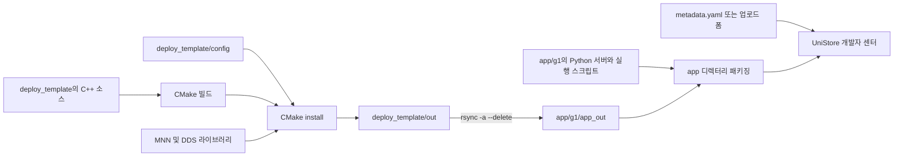

# G1 앱의 빌드, 산출물, 패키징 및 배포

[문서 색인](README.md) · [공식 제어 개념](g1-control-concepts.ko.md) · [실행 구조와 상태 전이](g1-mimic-runtime.ko.md)

## 1. 소스와 배포 디렉터리의 관계

`deploy_template/`은 C++ 제어기의 빌드 입력이고, `app/`은 UniStore에 전달할 실행 패키지이다.
`app/g1/app_out/`은 C++ 소스 디렉터리가 아니라 **설치된 산출물의 배포 복사본**이다.
Python HTTP 서버와 실행 스크립트는 그 바깥의 `app/g1/`에 있다.



일반적인 수정 위치는 다음과 같다.

| 수정하려는 내용 | 기준 위치 |
|---|---|
| 제어 로직·상태 전이·DDS 발행 | `deploy_template/main.cpp`, `src/`, `include/` |
| 정책 경로·게인·모션·모델 | `deploy_template/config/` |
| HTTP 처리·시작/정지 옵션 | `app/g1/*.py` |
| 배포 프로세스 실행 인자 | `app/g1/run_g1_ctrl.sh` |
| UniStore 시작 명령·권한·런타임 이미지 | `metadata.yaml` 또는 업로드 폼 |

`app_out/config`만 직접 바꾸면 다음 동기화 때 덮어쓰거나 삭제될 수 있다.
빌드 기준 설정은 `deploy_template/config`에서 관리하고 산출물을 다시 복사해야 한다.

기존 `app_out/`을 먼저 삭제할 필요는 없다.
자동 빌드 스크립트는 빌드·설치 성공 후 `rsync --delete`로 산출물과 일치시킨다.
다만 이 동기화는 목적지에만 있는 파일도 삭제한다. 배포 산출물 외의 파일을 그 안에 보관하면 안 된다.

## 2. 현재 저장소의 개발 환경과 공식 매뉴얼 예시의 차이

사용자가 제공한 공식 매뉴얼은 `g1_walk_demo`, `go2_action_demo`와 VS Code Dev Containers를
일반적인 예로 든다. 분석한 저장소에는 `g1_mimic_demo`가 있으며 해당 예제 이름의 디렉터리나
`.devcontainer` 설정이 없다.

따라서 현재 체크아웃을 대상으로 “VS Code가 자동으로 Reopen in Container를 제안하고
모든 의존성을 설치한다”고 안내할 수는 없다.
현재 저장소가 제공하는 구체적인 ARM64 빌드 경로는
[`Dockerfile.arm64-builder`](../g1_mimic_demo/Dockerfile.arm64-builder)와
[`docker_build_arm64.sh`](../g1_mimic_demo/docker_build_arm64.sh)이다.

이 빌더 컨테이너와 UniStore가 앱을 실행하는 런타임 이미지는 역할이 다르다.

| 환경 | 현재 정의 | 목적 |
|---|---|---|
| 빌더 | Ubuntu 20.04 기반 `g1-unistore-builder:ubuntu20.04-arm64` | C++ 컴파일·설치 |
| UniStore 런타임 | 메타데이터의 `image/sdk2_cpp_py:latest` | 업로드된 앱 실행 |

빌드 이미지에 Python이 설치되어 있다고 FastAPI 서버 실행 의존성까지 구성된 것은 아니다.
Dockerfile에는 `fastapi`, `uvicorn` 설치 명령이 없고, 메타데이터가 별도로 설치하도록 되어 있다.

## 3. 권장 빌드 경로: ARM64 Docker 빌드 및 자동 동기화

### 3.1 호스트 전제

빌드 스크립트 실행 호스트에 다음이 필요하다.

- Docker CLI와 동작 중인 Docker 엔진
- 호스트의 `rsync`
- Linux ARM64 컨테이너를 빌드하고 실행할 수 있는 환경
- 빌더 의존성 및 공식 SDK를 다운로드할 수 있는 네트워크

x86_64 호스트에서는 ARM64 프로그램 실행을 위한 에뮬레이션도 필요하다.
`--platform linux/arm64`만 지정하면 모든 호스트에서 자동으로 실행 가능해지는 것은 아니다.
빌드 중의 ARM64 `RUN` 명령과, 빌드 후 `docker run`의 ARM64 컴파일러 실행이 모두 가능해야 한다.
Docker Desktop의 지원과 별개로 Linux Docker 엔진의 구성에 따라 binfmt/QEMU 설정이 필요하다.
[Docker 공식 다중 플랫폼 설명](https://docs.docker.com/build/building/multi-platform/)

다음 명령은 별도 ARM64 컨테이너를 실행해 지원 여부를 확인하는 예이다.
이미지가 없으면 다운로드한다.

```bash
docker run --rm --platform linux/arm64 ubuntu:20.04 uname -m
```

정상적인 ARM64 실행이면 `aarch64`가 출력된다.
문서 작성 과정에서는 호스트에 에뮬레이터를 설치하거나 위 컨테이너를 실행하지 않았다.

### 3.2 실행 명령

저장소 루트를 기준으로 다음을 실행한다.

```bash
cd /hdd/Project/_unitree/unitree-app-templates/g1_mimic_demo
./docker_build_arm64.sh
```

스크립트는 다음 작업을 순서대로 한다.

1. `Dockerfile.arm64-builder`로 `linux/arm64` 빌더 이미지를 빌드한다.
2. 예제 디렉터리를 `/workspace`로 마운트한다.
3. 컨테이너의 작업 디렉터리를 `/workspace/deploy_template`으로 설정한다.
4. 그 안에서 `./install.sh`를 실행한다.
5. 호스트에서 `deploy_template/out/`을 `app/g1/app_out/`으로 동기화한다.

이미지가 존재해도 스크립트는 매번 `docker build`를 호출한다. 일반적인 Docker 레이어 캐시는 사용할 수 있다.
`set -euo pipefail`이므로 빌드나 컨테이너 실행이 실패하면 그 뒤의 동기화를 진행하지 않는다.

환경 변수는 다음과 같다.

| 변수 | 기본값 | 역할 |
|---|---|---|
| `DOCKER_IMAGE_NAME` | `g1-unistore-builder:ubuntu20.04-arm64` | 빌드·실행할 이미지 태그 |
| `APP_OUTPUT_DIR` | 예제의 `app/g1/app_out` 절대 경로 | 산출물 동기화 목적지 |
| `CONFIG_ENC_KEY` | `unitree-g1-config-key` | 컨테이너로 전달하는 환경 변수 |

현재 조사한 빌드·설치·로딩 코드에서 `CONFIG_ENC_KEY`를 이용한 설정 암호화는 확인되지 않는다.
변수 이름만 보고 `config.yaml`이나 모델이 암호화된다고 설명하면 안 된다.

예를 들어 기존 배포 복사본과 분리된 곳에 빌드 결과를 모으려면 다음처럼 절대 경로를 지정한다.

```bash
APP_OUTPUT_DIR=/tmp/g1-unistore-build-review ./docker_build_arm64.sh
```

이 경우에도 `deploy_template/build`와 `deploy_template/out`은 아래 설치 스크립트에 의해 재생성된다.

### 3.3 install.sh가 만드는 결과

[`install.sh`](../g1_mimic_demo/deploy_template/install.sh)는 현재 작업 디렉터리의
`build`, `out`을 지운 뒤 아래 작업을 수행한다.

```bash
rm -rf build out
cmake -S . -B build -DCMAKE_BUILD_TYPE=Release
cmake --build build -j
cmake --install build --prefix out
```

다른 위치에서 스크립트의 절대 경로만 실행하면 작업 기준이 달라진다.
수동 실행 시에도 반드시 `deploy_template/`으로 이동해야 한다.
컴파일에 실패하더라도 먼저 지운 기존 `build/out`은 복원되지 않는다.

설치 결과의 핵심 구조는 다음과 같다.

```text
deploy_template/out/
├── bin/
│   └── g1_ctrl
├── config/
│   ├── config.yaml
│   └── policy/...
└── lib/
    ├── libMNN*.so*
    └── libddsc*.so*  # DDS 탐색 경로에서 발견된 경우
```

현재 CMake는 `config/` 전체를 복사하고 MNN·DDS 공유 라이브러리를 설치한다.
DDS 라이브러리를 찾지 못하면 경고하므로, 디렉터리 이름만 보고 모든 필수 라이브러리가
항상 포함된다고 가정하면 안 된다.

## 4. 수동 빌드와 SDK 버전 고정

### 4.1 의존성이 준비된 환경에서 직접 빌드

대상 아키텍처용 컴파일러, SDK, DDS 및 CMake 의존성이 이미 준비된 환경이라면 다음을 사용할 수 있다.

```bash
cd /hdd/Project/_unitree/unitree-app-templates/g1_mimic_demo/deploy_template
./install.sh
rsync -a --delete out/ ../app/g1/app_out/
```

이것은 호스트의 `cmake`와 라이브러리를 사용한다.
x86_64 호스트에서 실행했다는 이유만으로 ARM64 바이너리가 만들어지는 것이 아니다.
CMake에 x86_64용 MNN 경로 분기는 있지만, 해당 배포 라이브러리의 실제 존재와 의존성까지
별도로 확인해야 한다. 현재 제공된 ARM64 Docker 경로와 동등하게 검증된 x86 실행 환경이라고
간주하지 않는다.

### 4.2 CMake 의존성과 링크

현재 [`CMakeLists.txt`](../g1_mimic_demo/deploy_template/CMakeLists.txt)는 C++17을 사용하고,
주요 의존성은 다음과 같다.

| 구성 | 주요 의존성 |
|---|---|
| 통신·서비스 | `unitree_sdk2`, `ddsc`, `ddscxx` |
| 추론 | 아키텍처별 MNN |
| 수학·설정·CLI | Eigen, yaml-cpp, Boost program_options |
| 로그·운영체제 | spdlog/fmt, pthread, rt |

ARM64 분기에는 `armv8.2-a` 및 SIMD/FP16/dotprod/CRC/crypto 옵션이 있다.
단순히 ARM64 ELF라는 사실만으로 모든 ARM64 CPU에 실행 호환된다고 보장하지 않는다.

실행 파일에는 `$ORIGIN`, `$ORIGIN/../lib`, `$ORIGIN/../config`를 사용하는 상대 RPATH 설정이 있다.
설치된 `bin`, `lib`, `config`의 형제 디렉터리 구조를 유지해야 한다.
`g1_ctrl` 하나만 임의의 위치로 복사하면 모델 경로와 공유 라이브러리 탐색이 모두 달라질 수 있다.

### 4.3 Docker SDK와 로컬 SDK는 자동으로 연결되지 않는다

Dockerfile은 기본적으로 공식 SDK 저장소의 `main`을 shallow clone하여 `/usr/local`에 설치한다.
`/hdd/Project/_unitree/unitree_sdk2`의 로컬 체크아웃을 자동으로 사용하는 구조가 아니다.
또한 SDK 배포본을 설치하는 과정이지 로봇 내부의 공식 제어기 펌웨어를 빌드하는 과정이 아니다.

Dockerfile은 `UNITREE_SDK2_REPO`, `UNITREE_SDK2_REF` build argument를 제공한다.
현재 clone 방식이 `--branch`이므로 ref에는 접근 가능한 브랜치·태그를 사용하는 것이 맞고,
임의 커밋 SHA를 그대로 전달해 항상 동작한다고 가정하면 안 된다.

상위 `docker_build_arm64.sh`는 이 build argument를 전달하지 않는다.
별도로 특정 ref의 이미지를 만들었더라도 상위 스크립트를 다시 실행하면 기본 인자로
`docker build`를 다시 호출한다. 재현 가능한 SDK 고정이 필요하면 빌드 인자 전달과
이미지 빌드·실행·동기화 절차를 함께 관리해야 한다.

Docker 캐시에 남아 있는 `main`과 실제 최신 `main`도 같다고 보장되지 않는다.
앱 소스 버전, SDK 버전, 빌더 이미지 식별자와 실행 이미지 버전을 함께 기록해야 결과를 추적할 수 있다.

### 4.4 SDK를 갱신해도 로컬 복사 헤더는 자동 갱신되지 않는다

템플릿에는 SDK와 동일한 include 경로의 `g1_loco_client.hpp`, `g1_loco_api.hpp`가 있다.
2026-11-18에 검토한 공식 SDK에는 `GetMimicMotion()`, `_fsm_api()`와 API 상수 `7100`이
있지만 템플릿의 복사본에는 없다. CMake는 로컬 `include`를 우선 사용한다.

따라서 빌더에 최신 SDK를 설치하는 것만으로 이 앱 소스에 `GetMimicMotion()` 메서드가
자동으로 추가되지는 않는다. 이 API를 앱에 새로 도입하려면 어떤 버전의 헤더를 실제로
컴파일하는지부터 확인해야 한다. 기존 `SetFsmId(int)`는 복사본에도 있으므로
복합 정수를 전송하는 메서드 자체가 없다는 뜻은 아니다.

이 문서 보강에서는 SDK나 앱 헤더를 교체하지 않았다.
공식 모션 API와 현재 앱의 차이는 [별도 검증 문서](g1-mimic-motion-api.ko.md)에 설명한다.

## 5. 저장소에 포함된 app_out은 현재 소스와 다르다

문서 작성 시 직접 검사한 결과는 다음과 같다.

| 항목 | 현재 deploy_template 소스·설정 | 포함된 app/g1/app_out |
|---|---|---|
| 추론 코드·실행 파일 의존성 | `MNNRunner`, `libMNN` 링크 | ARM64 실행 파일이 `libonnxruntime.so.1`에 의존 |
| Mimic 정책 경로 | `config/policy/mimic/unistore/` | `config/policy/mimic/gangnam_style/` |
| 모델 형식 | `gangnam_style.mnn` | `.onnx` 모델 경로 |

따라서 **현재 포함된 바이너리를 실행한 결과를 현재 C++ 소스의 동작이라고 단정할 수 없다**.
반대로 현재 소스를 빌드했더라도 `app_out`을 갱신하지 않고 패키징하면 이전 바이너리가 배포된다.

수정 후에는 실행 파일뿐 아니라 `out/` 전체를 동기화해야 한다.
새 MNN 실행 파일과 이전 ONNX용 설정을 섞거나, 바이너리만 바꾸고 모델·라이브러리를 남기면
정책 로딩 또는 동적 링크 단계에서 실패할 수 있다.

검사 예시는 다음과 같다. 이 명령은 실행 파일을 구동하지 않는다.

```bash
cd /hdd/Project/_unitree/unitree-app-templates/g1_mimic_demo
file app/g1/app_out/bin/g1_ctrl
readelf -d app/g1/app_out/bin/g1_ctrl
cat deploy_template/config/config.yaml
cat app/g1/app_out/config/config.yaml
```

ARM64 실행 파일의 의존성 확인에 x86 호스트의 `ldd` 실행 결과를 사용하면 안 된다.
`readelf -d`로 NEEDED를 확인하고, 실제 로딩 가능 여부는 대상 아키텍처와 호환되는 런타임에서 확인한다.
`fmt`, C++ 런타임, glibc 등은 CMake가 모두 함께 복사하지 않으므로 런타임 이미지와의 호환성도 필요하다.

## 6. 실행 환경과 설정 경로

`param::helper()`는 `/proc/self/exe`에서 실행 파일 위치를 읽는다.
부모 디렉터리 이름이 `bin` 또는 `build`이면 그 상위 디렉터리의 `config/config.yaml`을 사용한다.
예를 들어 배포 구조에서는 다음처럼 해석한다.

```text
/workspace/app/g1/app_out/bin/g1_ctrl
→ proj_dir = /workspace/app/g1/app_out
→ config = /workspace/app/g1/app_out/config/config.yaml
```

주요 실행 인자는 다음과 같다.

| 옵션 | 의미 |
|---|---|
| `-n`, `--network` | DDS 네트워크 인터페이스. 기본값은 빈 문자열 |
| `--log` | `proj_dir/log/log.txt`에 회전 로그 생성. 5MiB, 파일 수 인자 5 |
| `-h`, `--help` | CLI 도움말 |
| `-v`, `--version` | 코드에 설정된 버전 |

배포용 `app/g1/run_g1_ctrl.sh`는 `-n`을 전달하지 않는다.
따라서 특정 NIC가 코드에서 고정되는 것이 아니라 SDK의 기본 선택 동작을 사용한다.
CPU affinity는 `taskset -c 4-7`로 고정하므로 실행 환경에 해당 CPU가 허용되어 있어야 한다.

별도의 `deploy_template/run_g1_ctrl.sh`에는 `-n lo`가 있다.
개발용 스크립트와 앱 배포용 스크립트가 같은 인자를 사용한다고 가정하면 안 된다.

Python의 `EXECUTABLE_BIN`은 `/workspace/app/g1/run_g1_ctrl.sh` 절대 경로이다.
따라서 호스트에서 현재 디렉터리만 바꾸고 `python3 app/g1/cmd_server.py`를 실행해도
동일한 경로의 자식 프로세스를 찾는다고 보장되지 않는다.

근거: [param.h](../g1_mimic_demo/deploy_template/include/param.h),
[배포 실행 스크립트](../g1_mimic_demo/app/g1/run_g1_ctrl.sh),
[개발 실행 스크립트](../g1_mimic_demo/deploy_template/run_g1_ctrl.sh),
[Python 설정](../g1_mimic_demo/app/g1/config.py).

## 7. UniStore 패키징과 설치

### 7.1 패키지 구성

사용자가 제공한 공식 매뉴얼의 필수 구성은 `app/`이며,
앱은 포트 80에서 다음 HTTP 엔드포인트를 제공해야 한다.

```text
POST /api/action/start
POST /api/action/stop
```

이 템플릿은 두 경로를 선언하지만 현재 Stop은 기능적으로 연결되어 있지 않다.
그러므로 파일 구조와 엔드포인트 이름이 맞다는 이유만으로 시작·정지 요구사항을 모두 충족한다고
판정할 수 없다. 상세 동작은 [실행 문서](g1-mimic-runtime.ko.md)를 참고한다.

기본 패키징 예시는 다음과 같다.

```bash
cd /hdd/Project/_unitree/unitree-app-templates/g1_mimic_demo
tar -czvf g1_mimic_demo.tar.gz ./app
tar -tzf g1_mimic_demo.tar.gz
```

이 명령은 `app/`만 압축하며 `metadata.yaml`은 포함하지 않는다.
압축 파일의 최상위가 `app/`이어야 한다. `deploy_template/` 전체를 앱 실행 디렉터리 대신
압축하는 방식과 구분한다.

### 7.2 Metadata 방식과 Form 방식

사용자가 제공한 공식 매뉴얼은 두 업로드 방식을 구분한다.

| 방식 | 메타데이터 처리 |
|---|---|
| Form Method | 업로드 UI의 폼에서 필요한 항목 입력 |
| Metadata Method | `metadata.yaml` 필수 |

따라서 메타데이터 파일이 모든 업로드 방식에서 무조건 필수라고 설명하면 정확하지 않다.
Metadata 방식에서는 업로드 UI가 지정하는 위치에 메타데이터를 함께 제출한다.
매뉴얼의 `tar ./app` 예시만으로 메타데이터가 반드시 압축 내부인지 별도 첨부인지까지
확정할 수 없으므로 해당 화면의 제출 규칙을 따른다.

현재 [`metadata.yaml`](../g1_mimic_demo/metadata.yaml)의 핵심 값은 다음과 같다.

| 필드 | 현재 값·역할 |
|---|---|
| `version` | `v0.1.0` |
| `base_image` | `image/sdk2_cpp_py:latest` |
| `permissions` | `camera`, `motor` |
| `startup_commands` | `python3 /workspace/app/g1/cmd_server.py` |
| `build_env` | apt로 Python·pip 설치 후 FastAPI·Uvicorn 설치 |

현재 `build_env`는 C++ 소스를 빌드하는 명령이 아니다. CMake 호출이 없으므로
업로드 전에 `app_out`이 올바르게 준비되어 있어야 한다.
또한 현재 명령에 적힌 apt 패키지명은 `pip`이다. 빌더 Dockerfile의 `python3-pip`와 다르므로
선택한 실제 런타임 이미지에서 해당 명령의 유효성을 별도로 확인해야 한다.

### 7.3 설치의 의미와 검증 범위

이 저장소의 `install.sh`는 **CMake 산출물을 out에 설치**하는 스크립트이다.
로봇에 SSH 접속하여 앱을 등록하거나 UniStore에 업로드하는 설치기가 아니다.
로봇에서의 설치·실행은 패키지 업로드와 UniStore의 배포 절차에 따른다.

문서 작성 과정에서 ARM64 전체 빌드, UniStore 업로드, 로봇 설치 및 실제 모터 제어는 수행하지 않았다.
SDK·런타임 이미지가 갱신될 수 있으므로 실제 배포 성공 여부는 해당 환경에서 확인해야 한다.

## 8. 시뮬레이션 시 주의할 개념 경계

저장소 설명처럼 발행 토픽을 `rt/lowcmd`로 바꾸고 NIC를 `lo`로 지정하는 것은 통신 경로 변경이다.
그 두 변경만으로 현재 UserCtrl 앱이 모든 시뮬레이터에서 그대로 작동한다고 보장되지 않는다.

현재 Mimic은 여전히 다음 동작을 한다.

- `GetFsmId()` 호출
- `SwitchToUserCtrl()` 요청
- 이후 FsmId 1000 확인
- 종료 시 `SwitchToInternalCtrl()` 요청

시뮬레이터가 대응하는 sport RPC를 구현하지 않으면 이 제어권 확인 경로도 별도로 다뤄야 한다.
`mode_machine=0`을 허용하는 기체 확인 예외는 RPC 서비스를 대신 구현하는 기능이 아니다.
모든 시뮬레이터가 `mode_machine=0`을 보고한다는 가정도 할 수 없다.

기존 Debug Mode용 `rt/lowcmd` 제어 환경과 UniStore용 UserCtrl 환경은 진입 절차가 다르다.
현재 앱을 실행하기 위한 공통 준비 단계로 `ReleaseMode()`를 무조건 추가하는 것은 맞지 않는다.
그 호출은 이 앱이 의존하는 공식 고수준 서비스 환경을 해제하는 별도 경로이기 때문이다.
