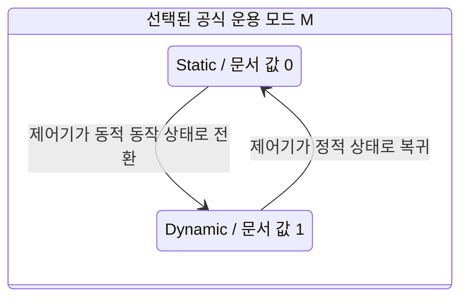
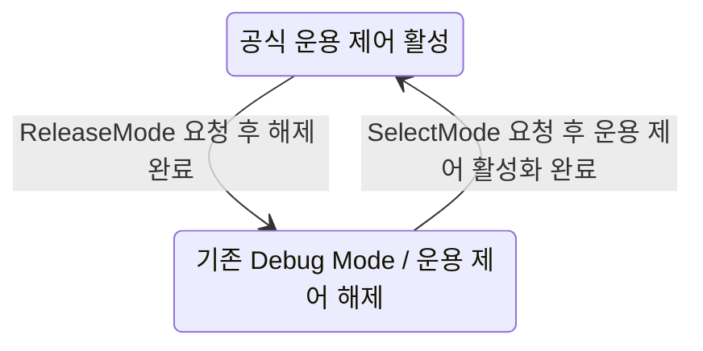
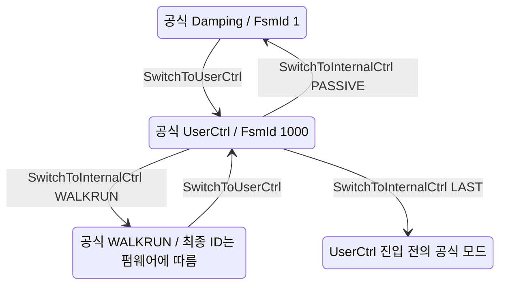

# G1 공식 제어 모드, FSM 및 DDS 인터페이스

[문서 색인](README.md) · [앱의 실제 상태 전이](g1-mimic-runtime.ko.md) · [빌드 및 배포](g1-build-and-deploy.ko.md)

모델별 최종 ID와 설치 앱의 등록 범위는 [FsmId 통합 참조본](fsm-id-reference.ko.md)을 기준으로 읽는다.
이 문서의 G1 번호·서비스 설명을 H1·H2에 그대로 적용하지 않는다.

## 1. 서로 다른 숫자 체계를 먼저 구분한다

FSM은 Finite State Machine, 즉 유한 상태 머신이라는 설계 방식이다.
Unitree의 특정 서비스만을 가리키는 고유 이름이 아니다.
로봇의 공식 제어기와 사용자 앱은 각각 자기 상태 머신을 가질 수 있다.

| 구분 | 관리 대상 | 확인·설정 위치 | 예 |
|---|---|---|---|
| 공식 `FsmId` | 운용·제어 모드의 선택·조회 및 모션별 호출값 | `LocoClient::GetFsmId()`, `SetFsmId()` | Damping `1`, UserCtrl `1000`, Mimic 호출 `550507` |
| 공식 `FsmMode` | 해당 모드의 정적·동적 상태 | `GetFsmMode()`, `SportModeState.fsm_mode` | 문서의 Static `0`, Dynamic `1` |
| `InternalFsmMode` | UserCtrl에서 공식 제어기로 돌아갈 대상 | `SwitchToInternalCtrl()` 인자 | LAST `0`, PASSIVE `1`, WALKRUN `2` |
| `mode_machine` | 기체의 하드웨어 구성 식별 | `LowState`와 `LowCmd` 필드 | 특정 G1 29자유도 구성 `5` |
| 앱 내부 상태 ID | `g1_ctrl`의 실행 단계 | YAML의 `FSM._`, `CtrlFSM` | Passive `1`, Mimic `3`, Exit `4` |
| Arm Action의 동작 ID | 팔 서비스가 실행할 동작 | `ExecuteAction()`, 팔 동작 상태 토픽 | 해제 동작 `99`, 악수 `27` |
| Mimic 모션 API ID | 공식 Mimic 모션 목록의 개별 동작 | `GetMimicMotion()` 응답의 `motion` 키 | SDK 예시 `507` |

숫자가 같아도 서로 다른 체계의 값은 연결되지 않는다.
예를 들어 앱의 `Mimic=3`은 공식 `SitDown=3`과 관계가 없다.
또한 복귀 선택값 `WALKRUN=2`는 공식 `FsmId=2`를 뜻하지 않는다.
모션 ID에 `501`이 있더라도 공식 운용 모드 `FsmId=501`과는 별개의 값이다.

### 1.1 관련 RPC의 서비스와 API 번호

| 서비스 | 클라이언트 메서드 | API 번호 | 요청·결과의 성격 |
|---|---|---:|---|
| `sport` | `GetFsmId()` | `7001` | 공식 모드 번호 조회 |
| `sport` | `GetFsmMode()` | `7002` | 공식 모드의 상태 조회 |
| `sport` | `GetMimicMotion()` → `_fsm_api()` | `7100` | `fsm_id=550`, `api_id=1`로 모션 목록 조회 |
| `sport` | `SetFsmId()` | `7101` | 공식 모드 번호를 지정한 전환 요청 |
| `sport` | `SwitchToUserCtrl()` | `7110` | 사용자 제어 모드 진입 요청 |
| `sport` | `SwitchToInternalCtrl()` | `7111` | 복귀 선택값을 지정한 공식 제어 복귀 요청 |
| `motion_switcher` | `CheckMode()` | `1001` | 운용 모드 이름 및 형식 조회 |
| `motion_switcher` | `SelectMode()` | `1002` | 운용 모드 이름으로 선택 |
| `motion_switcher` | `ReleaseMode()` | `1003` | 기존 운용 제어 해제 요청 |

`SwitchToUserCtrl()`과 `ReleaseMode()`는 서로 다른 서비스에 대한 서로 다른 요청이다.
현재 SDK의 공식 제어 복귀 메서드는 `SwitchToInternalCtrl()`이며 `ReleaseUserCtrl()`이 아니다.
운용 모드 선택 메서드도 `SelectMode()`이다.

`GetMimicMotion()` 및 API `7100`은 분석한 공식 SDK에 존재하지만,
템플릿이 복사해 둔 Loco 헤더에는 없다. 표의 모든 메서드가 템플릿 로컬 헤더에 있다는 뜻은 아니다.

근거: [공식 G1 Loco 클라이언트][ref-loco-current], [공식 G1 Loco API 상수][ref-loco-api-current],
[템플릿 Loco API 상수](../g1_mimic_demo/deploy_template/include/unitree/robot/g1/loco/g1_loco_api.hpp),
[공식 Motion Switcher API 상수][ref-motion-api], [공식 Motion Switcher 클라이언트][ref-motion-client].

## 2. 공식 FsmId: 운용 모드와 모션별 호출값

### 2.1 공식 문서에 명시된 항목

다음은 [공식 운동 서비스 문서][ref-sport]의 Expert Interface에 있는 모드 표이다.
상태 간에 임의로 전환할 수 있다는 의미의 표가 아니며, `SetFsmId()`의 전체 호출값 목록도 아니다.
같은 공식 문서의 Dance Mode 절은 아래 표와 별도로 Mimic 모션의 `550` 접두사 규칙을 설명한다.

| FsmId | 공식 영문 명칭 | 문서에서 확인되는 구분 |
|---:|---|---|
| `0` | Zero Torque | 균형 제어 없음 |
| `1` | Damping | 균형 제어 없음 |
| `2` | Position Control Squat | 위치 제어 하강 자세, 균형 제어 없음 |
| `3` | Position Control Sit Down | 위치 제어 착석 자세, 균형 제어 없음 |
| `4` | Lock Standing | 잠금 기립, 균형 제어 없음 |
| `1000` | User Control Mode / UserCtrl | 사용자 전신 제어 모드 |
| `1001` | Adaptive Stand-up Mode | 적응형 일어나기 모드 |
| `706` | Balance Squat, Squat Stand | 균형 하강·기립 동작 |
| `702` | Lie Down, Stand Up | 누운 자세에서의 기립 동작 |
| `500` | Walk Motion | 중문 표의 일반 운용 제어 |
| `501` | Walk Motion–3DoF-waist | 중문 표의 일반 운용 제어, 3자유도 허리 구성 |
| `801` | Run | 중문 표의 보행·주행 제어 |

공식 문서는 일부 29자유도 기체의 `ai_sport` 8.6.x.x 이후 버전에서 `801`이 `802`로
갱신됐다고 적는다. 이 설명만으로 모든 기체의 모든 setter 입력과 조회 결과가 같은 규칙으로
변환된다고 확정할 수는 없다. 지원되는 모드와 최종 도달 ID는 대상 펌웨어 기준으로 확인해야 한다.

### 2.2 GetFsmId의 반환값과 출력 인자

```cpp
int fsm_id = -1;
int32_t ret = client.GetFsmId(fsm_id);
```

- `ret`는 RPC 호출 결과이다. SDK 구현은 `ret == 0`일 때만 `fsm_id`를 갱신한다.
- `fsm_id`는 성공 응답에 포함된 공식 상태 번호이다.
- `ret`와 `fsm_id`는 같은 값이 아니다.
- 호출에 실패하면 기존 `fsm_id` 값이 그대로 남을 수 있다.

`SetFsmId()`가 반환하는 코드도 상태 번호가 아니다.
공식 문서는 최종 전환 결과가 로봇 측 전환 논리에 달려 있다고 설명한다.
요청 결과와 최종 상태를 분리해서 확인해야 한다.

근거: [템플릿에 포함된 LocoClient](../g1_mimic_demo/deploy_template/include/unitree/robot/g1/loco/g1_loco_client.hpp),
[공식 운동 서비스 문서][ref-sport].

### 2.3 Mimic 모션의 550 접두사

최신 공식 문서와 공식 SDK는 다음 경로를 제공한다.

1. `GetMimicMotion(data)`로 현재 로봇이 제공하는 Mimic 모션 목록을 조회한다.
2. 응답의 `motion` 키에 있는 모션 API ID를 선택한다.
3. `550`과 그 ID를 이어 만든 정수를 `SetFsmId()`에 전달한다.

공식 예시는 모션 API ID `507`에 대한 `SetFsmId(550507)`이다.
`501`이 실제 목록에 있다면 같은 규칙의 호출값은 `550501`이다.
이 접미사의 공식 SDK 용어는 **`motion_api_id`**이며, UniStore의 `app_id`라고 정의되어 있지 않다.

여기서 복합 숫자는 **모션 실행을 요청할 때의 목표 ID**로 확인된다.
실행 중 `GetFsmId()`가 그 숫자를 계속 반환하는지, 내부에서 반드시 `1000`으로 바뀌는지까지
동일한 계약으로 확장하지 않는다. 공개 클라이언트의 `SetFsmId()`는 숫자를 API `7101`로 보낼 뿐,
그 안에서 `SwitchToUserCtrl()`이나 `SwitchToInternalCtrl()`을 호출하지 않는다.

현재 `g1_mimic_demo`도 이 모션 호출 경로를 사용하지 않는다.
이 앱은 HTTP 입력 → 앱 Mimic 상태 → 명시적인 UserCtrl 진입 → 외부 정책 실행 경로를 사용한다.
두 경로의 상태 전이도, 정확한 필드 구분과 미확정 항목은
[Mimic 모션 API 검증 문서](g1-mimic-motion-api.ko.md)에 정리했다.
동일 sport 서비스에서 **모션 선택과 제어권 인계의 의미가 다른 이유**, 실제 RPC parameter,
앱·공식 상태의 결합 전이 및 복원 SDK의 구현 범위는
[FSM 연결 심화 분석](g1-fsm-dispatch-and-handoff.ko.md)을 참고한다.

근거: [공식 운동 서비스의 Dance Mode 절][ref-sport], [공식 G1 Loco 클라이언트][ref-loco-current].

## 3. 공식 FsmMode: 모드의 정적·동적 상태

### 3.1 공식 문서의 두 설명

| 위치 | `0` | `1` |
|---|---|---|
| `GetFsmMode()` 설명 | 서 있는 상태 | 이동 상태 |
| `SportModeState.fsm_mode` 설명 | Static: 다른 모드로 전환 가능한 정적 상태 | Dynamic: 대부분의 모드로 전환이 제한되는 동적 상태 |

`FsmId`는 운용 모드의 종류이고, `FsmMode`는 그 운용 모드의 현재 상태를 구분한다.
보행 제어 모드를 선택한 상태에서도 정적으로 대기할 수 있으므로 둘은 같은 정보가 아니다.
`FsmMode`는 속도 벡터나 센서 측정값 자체가 아니라 공식 제어기가 보고하는 상태 필드이다.

공식 문서는 현재 동작·자세가 전환에 적합하지 않을 때 모드 변경을 제한한다고 설명한다.
Static은 전환 판단에 사용하는 정보이며, 모든 목표 모드로의 성공을 보장하는 인증값은 아니다.
출발 모드, 대상 모드, 펌웨어의 전환 규칙도 함께 적용된다. [공식 정의][ref-sport]

이 필드를 조회하면 전환 가능성을 판단하는 데 도움이 되지만,
모든 `FsmMode` 값이 오직 모드 전환 허용 여부 하나를 표현하도록 만들어졌다고 단정하지 않는다.
공식 문서가 제공하는 정의는 해당 운용 모드의 상태이다.

### 3.2 개념 상태 전이도

아래는 정적·동적 상태의 의미를 나타내는 개념도이다.
모든 `FsmId`에서 동일한 이벤트·전이 규칙을 사용한다는 뜻은 아니다.



이 그림의 두 상태 사이에서 `FsmId`가 반드시 바뀌는 것은 아니다.
이 문서는 특정 모드의 내부 실행 단계를 공개 소스 없이 추가로 추측하지 않는다.

### 3.3 문서의 0·1 설명을 전체 값의 열거형으로 단정하지 않는다

[공식 SDK의 Arm Action 오류 헤더][ref-arm-error]에는 `FsmId=801`에서 일부 팔 동작을
허용하는 `fsm_mode` 값으로 `{0, 3}`이 적혀 있다.
따라서 공개된 실제 인터페이스의 모든 값이 반드시 `0`과 `1`뿐이라고 단정할 수 없다.

이 헤더는 `3`의 의미를 정의하지 않는다.
이 문서도 `3`을 정적 상태, 보행 상태, 팔 제어 상태 등으로 임의 해석하지 않는다.
또한 Arm Action에 적힌 조건을 `rt/arm_sdk` 직접 제어의 조건으로 옮겨 적용하지 않는다.

## 4. InternalFsmMode: UserCtrl에서의 복귀 선택값

`SwitchToInternalCtrl()`은 UserCtrl에서 공식 제어기로 복귀를 요청한다.
현재 SDK의 인자와 전송값은 다음과 같다.

| 인자 | API 7111에 보내는 값 | 문서상 의미 |
|---|---:|---|
| `InternalFsmMode::LAST` | `0` | UserCtrl에 진입하기 전의 공식 운용 모드로 복귀 |
| `InternalFsmMode::PASSIVE` | `1` | 공식 Damping 모드로 복귀 |
| `InternalFsmMode::WALKRUN` | `2` | 공식 보행·주행 모드로 복귀 |

`LAST`는 앱의 이전 상태나 이전 관절 자세를 복원한다는 뜻이 아니다.
이전 **공식 운용 모드**가 대상이다.
이 설명만으로 종료한 `550xxx` 모션을 재실행하거나 중단 지점부터 재개한다고 해석하지 않는다.
현재 템플릿의 정상 종료 경로는 `LAST`가 아니라 자세에 따른 `PASSIVE` 또는 `WALKRUN`이다.

다음 두 호출은 서로 다른 요청이다.

| 호출 | API | 전송하는 data | 현재 템플릿 SDK에서의 의미 |
|---|---:|---:|---|
| `SetFsmId(2)` | `7101` | `2` | `Squat()`가 사용하는 공식 상태 요청 |
| `SwitchToInternalCtrl(WALKRUN)` | `7111` | `2` | 공식 보행·주행 모드로 복귀 요청 |

근거: [LocoClient 전송 구현](../g1_mimic_demo/deploy_template/include/unitree/robot/g1/loco/g1_loco_client.hpp),
[공식 User Development Mode 설명][ref-sport], [UniStore 전환 매뉴얼][ref-switch].

### WALKRUN과 500·501·801·802의 대응 범위

공식 중문 문서는 `500/501`을 일반 운용 제어, `801/802`를 보행·주행 제어로 구분한다.
복귀 인자 `WALKRUN`도 보행·주행 모드라는 이름을 사용한다.

그러나 공개 클라이언트는 `WALKRUN`을 특정 `FsmId` 숫자로 변환하지 않는다.
선택값 `2`를 API `7111`로 보내며, 실제 대상은 로봇 측에서 결정한다.
따라서 모든 기체·펌웨어에서 `WALKRUN == 801`, `WALKRUN == 802` 또는 `WALKRUN == 500`이라고
고정 등식으로 기록하지 않는다. 최종 ID는 성공한 조회로 확인해야 한다.

## 5. Damping, 기존 Debug Mode, UserCtrl은 구분한다

| 구분 | 성격 | 공식 운용 제어와의 관계 | 사용자 명령 경로 |
|---|---|---|---|
| Damping | 공식 `FsmId=1`의 모드 | 공식 제어기가 감쇠 제어 수행 | 이 상태 자체가 사용자 제어권을 부여하지 않음 |
| 기존 Debug Mode | 공식 운용 제어를 해제하고 저수준 개발하는 환경 | 공식 문서상 기존 운용 제어가 종료되어 관련 고수준 서비스가 유효하지 않음 | `rt/lowcmd` |
| UserCtrl | 공식 `FsmId=1000`의 사용자 전신 제어 모드 | 진입·복귀 인터페이스를 통한 임시 제어권 인계 | `rt/user_lowcmd` |

사용자가 관절을 직접 제어할 수 있다는 공통점 때문에 기존 Debug Mode와 UserCtrl을
동일한 상태로 취급하면 안 된다.
또한 Damping에서 Debug Mode로 들어가는 준비 절차가 있다고 해서 두 상태가 같은 것도 아니다.

공식 리모컨 문서는 Damping과 ZeroTorque에서 Debug Mode로 들어가는 절차를 별도로 설명한다.
여기서 운용 제어를 해제한다는 것은 로봇의 모든 펌웨어·보호 기능이 꺼진다는 뜻이 아니다.
공개 자료만으로 Linux 프로세스별 종료·유지 구현까지 단정하지 않는다.

근거: [Motion Switcher 문서][ref-motion], [고수준 서비스의 Debug Mode 설명][ref-sport],
[리모컨 모드 설명][ref-remote].

### 5.1 기존 Motion Switcher 경로의 상태 전이도

다음은 운용 환경 수준의 전환이다. 공식 `FsmId` 전체의 전이도가 아니다.



`ReleaseMode()`는 `MotionSwitcherClient`의 요청이며, 공식 `FsmId`를 입력받지 않는다.
`Release`라는 공식 상태 ID를 선택하는 API도 아니다.
`CheckMode()`는 운용 모드의 이름 등을 조회하고, `SelectMode()`는 운용 모드를 선택한다.

실제 [공식 저수준 양팔 예제][ref-low-example]는 `ReleaseMode()`를 요청한 뒤
`CheckMode()`의 모드 이름이 비었는지 검사하여 운용 제어 비활성화를 판단한다.
이 경로의 준비 완료를 `FsmId=1`이나 `FsmId=1000`으로 판정하지 않는다.

### 5.2 UserCtrl 경로의 상태 전이도

아래는 [UniStore 전환 매뉴얼][ref-switch]이 설명하는 진입 출발점과 복귀 선택지이다.
모든 공식 상태 사이의 전환을 표현하지 않는다. 각 화살표는 요청이 허용되고 실제 완료된 경우이다.



`PreviousOfficialMode`는 새로운 공식 ID가 아니라 `LAST`의 의미를 표시하는 도식상의 이름이다.
매뉴얼은 춤 동작에는 WALKRUN, 일어나기 동작에는 PASSIVE에서의 진입을 권장한다.
이는 `g1_mimic_demo`의 별도 진입 조건과 구분해야 한다.

분석한 [공식 UserCtrl DDS 예제][ref-user-example]도 최초 `GetFsmId()`가 Damping `1`인지
확인한 후 `rt/user_lowcmd` 발행과 `SwitchToUserCtrl()`을 사용한다.
이는 Damping 자체가 이미 UserCtrl이라는 의미가 아니라, Damping을 **출발 상태**로 사용해
별도의 UserCtrl 진입을 요청하는 구체적인 예이다.

## 6. 세 가지 명령 토픽과 상태 피드백

| 토픽 | 메시지·용도 | 제어 환경 |
|---|---|---|
| `rt/lowcmd` | G1의 `LowCmd_` 모터 명령 | 공식 SDK의 기존 Debug Mode 저수준 예제 |
| `rt/user_lowcmd` | 같은 G1 `LowCmd_` 모터 명령 | UserCtrl에서 사용자 전신 제어 |
| `rt/arm_sdk` | `LowCmd_`를 이용한 상체 명령 및 제어 가중치 | 공식 운용 제어를 사용하는 상체 제어 인터페이스 |
| `rt/lowstate` | 관절 상태, IMU 등을 담은 `LowState_` | 실제 로봇 상태 피드백 |
| `rt/sportmodestate` | `SportModeState_` | 공식 `fsm_id`, `fsm_mode`, `task_id`, `task_time` |

`LowCmd`는 함수가 아니라 메시지 타입 또는 그 메시지의 발행·구독 래퍼 이름이다.
메시지를 발행할 수 있다는 것과 로봇이 그 명령을 모터 제어에 반영한다는 것은 다르다.
발행 함수의 성공만으로 해당 제어권을 획득했다고 판단하지 않는다.

`rt/lowcmd`와 `rt/user_lowcmd`의 차이는 trajectory 전용과 실시간 제어 전용의 구분이 아니다.
사용자 프로그램은 각 경로에서 참조 동작 재생이나 상태 기반 제어 계산을 수행할 수 있다.
명령 주기도 토픽 이름이 정하지 않는다.

### 6.1 LowCmd의 주요 필드

| 필드 | 이 저장소에서의 사용 |
|---|---|
| `mode_machine` | 기체 구성 호환성 확인 |
| `motor_cmd[i].mode` | 모터 명령 모드 필드. 앱 Passive 설정에서 초기화 |
| `motor_cmd[i].q` | Mimic의 목표 관절각 |
| `motor_cmd[i].dq` | Mimic에서는 `0`으로 설정 |
| `motor_cmd[i].kp`, `kd` | 정책 설정의 stiffness·damping 값 |
| `motor_cmd[i].tau` | Mimic에서는 추가 토크를 `0`으로 설정 |
| `crc` | Publisher가 발행 직전에 계산 |

`mode_machine`, 모터별 `mode`, 공식 `FsmMode`는 서로 다른 필드이다.
`LowCmd_`의 모터 슬롯 수와 기체의 실제 자유도 수도 같은 개념이 아니다.
예를 들어 G1 메시지는 35개 모터 명령 슬롯을 가지지만, 현재 Mimic 정책은 29개 관절을 사용한다.

## 7. mode_machine은 기체 구성 ID

`mode_machine`은 모터 수 그 자체가 아니라 기체 구성·리비전을 구분하는 코드이다.
같은 29자유도라도 감속비, 손목 모터, 허리 구성 등에 따라 코드가 다를 수 있다.
숫자가 크다고 반드시 더 최신이거나 상위 제품이라는 뜻은 아니다.

확인 예시는 다음과 같다. 전체 목록은 [공식 모델 대응표][ref-model]를 따른다.

| 값 | 공식 모델 표의 예 |
|---:|---|
| `4` | `g1_23dof_rev_1_0` |
| `5` | `g1_29dof_rev_1_0` 및 일부 손 부착 구성 |
| `6` | `g1_29dof_lock_waist_rev_1_0` |
| `10` | 다른 구성의 G1 23자유도 |
| `11`~`16`, `18` | 각각 다른 하드웨어 구성의 G1 29자유도 |

현재 앱은 명령 메시지의 `mode_machine`을 `5`로 설정한다.
`check_mode_machine()`은 다음 조건을 검사한다.

```cpp
return m_sub == 0 || m_sub == m_pub;
```

- `m_sub`: 로봇의 `LowState.mode_machine`에서 받은 구성 ID.
- `m_pub`: 사용자 명령의 `LowCmd.mode_machine`에 설정한 구성 ID.
- 로봇이 `5`를 보고하면 현재 설정 `5`와 일치하여 통과한다.
- 로봇이 `4`나 다른 비영 값을 보고하면 일치하지 않아 실패한다.
- `m_sub=0`은 이 검사 함수가 예외적으로 허용한다. 주석은 시뮬레이션을 설명한다.

마지막 항목은 모든 시뮬레이터가 반드시 `0`을 발행한다는 뜻이 아니다.
`m_pub=0`이 모든 실기체에 대한 와일드카드라는 뜻도 아니다.
또한 명령 필드에 `5`를 대입하는 행위 자체가 로봇 종류나 공식 FSM을 바꾸지 않는다.

근거: [기체 구성 검사](../g1_mimic_demo/deploy_template/include/unitree/dds_wrapper/robots/g1/g1_pub.h),
[main.cpp](../g1_mimic_demo/deploy_template/main.cpp).

## 8. rt/arm_sdk 직접 제어의 사용 조건

### 8.1 지원되는 공식 모드에 있어야 한다

`rt/arm_sdk`는 공식 운용 상태와 무관하게 어떤 상태에서나 적용되는 독립 제어 경로가 아니다.
[공식 DDS 인터페이스 설명][ref-sport]은 지원 모드를 다음 이름으로 제한한다.

- 잠금 기립 / Locked Stance.
- 운용 모드 1 / Movement Control 1.
- 운용 모드 2 / Movement Control 2.

공식 ID 표에서 잠금 기립은 `FsmId=4`로 명시된다.
같은 ID 표에는 일반 운용 제어 `500`, 3자유도 허리 일반 운용 제어 `501`, 보행·주행 제어
`801/802`도 있다. 그러나 DDS 절은 위의 운용 모드 1·2와 현재 숫자 표를 일대일로 연결하는
완전한 대응표를 제공하지 않는다.

따라서 이 문서는 다음 둘을 구분한다.

| 확인할 내용 | 판정 |
|---|---|
| `rt/arm_sdk` 적용에 공식 운용 모드 조건이 있는가 | 문서상 있음 |
| 잠금 기립의 공식 ID는 무엇인가 | 공식 표에서 `4` |
| Damping이면 사용자 상체 제어권이 자동으로 생기는가 | 그런 계약은 없음. 문서의 DDS 지원 모드 목록에도 없음 |
| `UserCtrl=1000`으로 전환해야 사용하는가 | 그 경로가 아님. UserCtrl의 전신 제어 토픽은 `rt/user_lowcmd` |
| 모든 펌웨어의 전체 허용 ID가 `{4,500,501}`로 완전히 확정되는가 | 공개 DDS 설명만으로 확정하지 않음 |
| `801/802`에서의 동작을 모든 기체에 보장할 수 있는가 | 공개 DDS 설명만으로 보장하지 않음 |

필요한 것은 **실행 시 지원 모드에 있는 것**이다.
이미 리모컨 등으로 해당 모드에 진입했다면 사용자 프로그램이 다시 `SetFsmId()`를 호출해야
한다는 뜻은 아니다. 반대로 공식 예제가 모드 설정 코드를 생략했다고 해서 모든 상태에서
적용된다는 뜻도 아니다.

현재 대상 로봇의 펌웨어가 특정 ID에서 실제 상체 명령을 수용하는지는 별도의 실기체 확인 범위이다.
이 문서는 로봇을 움직여 그 범위를 검증하지 않았다.

### 8.2 명령의 범위와 가중치

공식 문서는 G1의 상체 명령 필드를 다음과 같이 설명한다.

| 모터 명령 인덱스 | 역할 |
|---|---|
| `12`~`28` | 허리 및 상체 모터 제어 파라미터 |
| `29`의 `q` | 상체 제어 가중치, 범위 `0.0`~`1.0` |

가중치는 `FsmId`나 `FsmMode`가 아니다.
공식 예제는 이 필드를 이용해 상체 제어를 사용하고, 종료 시 가중치를 `0`으로 돌린다.
이 경로를 사용하려고 공식 운용 제어 전체를 `ReleaseMode()`로 해제하는 구조가 아니다.

상체 직접 제어를 개발할 때 공식 Arm Action 서비스와의 충돌도 별도 문제이다.
[Arm Action 문서][ref-arm]는 직접 `/arm_sdk` 개발 시 내장 팔 서비스 `g1_arm_example`을
종료하도록 안내한다. 이 팔 서비스의 종료와 전체 운용 모드의 `ReleaseMode()`는 구분한다.

## 9. Arm Action 서비스와 공식 FSM의 관계

### 9.1 별도 서비스이지만 공식 상태에 종속된다

Arm Action은 서비스 이름 `arm`의 RPC 인터페이스이다.
사용자는 관절별 목표값 대신 사전 정의된 동작 ID나 교시 동작 이름을 전달한다.
공식 SDK는 이 컨트롤러가 `rt/arm_sdk`를 기반으로 한다고 설명한다.

공개 API에는 팔 전용의 별도 `GetFsmId()`·`SetFsmId()`가 없다.
대신 팔 동작의 허용 조건으로 공식 운동 제어기의 상태를 사용한다.
로봇 측 서비스가 내부적으로 어떤 상태 머신을 갖는지는 공개 클라이언트만으로 확정하지 않는다.

| 오류 | 공식 Arm Action 의미 |
|---:|---|
| `7400` | 관련 토픽 점유 |
| `7401` | 이전 동작의 자세 유지 중. 해제 또는 해당 동작에 맞는 처리 필요 |
| `7402` | 유효하지 않은 동작 ID |
| `7404` | 현재 공식 FsmID에서는 해당 동작 실행 불가 |

[공식 SDK 오류 헤더][ref-arm-error]의 `{500,501,801}` 및 `801`에서의 `fsm_mode={0,3}` 주석은
**Arm Action의 조건**이다. 상체 직접 제어의 모든 지원 상태를 정의하는 표로 사용하지 않는다.
특정 동작의 조건과 사용 가능한 동작 목록은 `GetActionList()`의 서버 응답도 확인해야 한다.

### 9.2 팔 동작 상태와 운동 제어기 상태는 별도 정보이다

| 토픽·인터페이스 | 상태 정보 |
|---|---|
| `rt/sportmodestate` | 공식 `fsm_id`, `fsm_mode`, 상체 작업의 `task_id`, `task_time` |
| `rt/arm/action/state` | 팔 동작의 `id`, `name`, `holding` |
| `GetActionList()` | 현재 펌웨어의 동작 목록과 개별 요구 조건 |

`rt/arm/action/state`의 `id`는 공식 `FsmId`가 아니다.
예를 들어 `99`는 팔 동작 해제에 사용하는 번호이고, `27`은 악수 동작 번호이다.
교시 동작은 SDK 설명상 `id=100`과 동작 이름으로 표현한다.

SDK는 일부 사전 정의 동작이 마지막 자세를 유지할 수 있고, `99` 또는 같은 동작 ID로
해제할 수 있다고 설명한다. 상태 토픽 주석에는 최대 20초 후 해제된다고 적혀 있다.
교시 동작의 주석은 `holding`을 사용하지 않는다고 설명한다.
이 역시 팔 동작의 유지·해제 계약이며, 공식 FsmId가 자동으로 어떤 값으로 바뀐다는 뜻은 아니다.

이는 별도 진행 상태를 제공한다는 뜻이지, 공식 FSM과 무관하게 실행된다는 뜻이 아니다.
팔 서비스는 공식 운용 제어에 의존하며, 기존 Debug Mode에서는 유효하지 않다고 공식 문서가 설명한다.

근거: [공식 G1ArmActionClient][ref-arm-client], [Arm Action 공식 문서][ref-arm].

## 10. 이 문서에서 확정하지 않는 항목

다음은 공개 자료에서 확인한 범위를 넘으므로 구현 사실로 기록하지 않는다.

- `WALKRUN` 복귀 선택값이 모든 펌웨어에서 정확히 어느 숫자 ID로 끝나는지.
- `rt/arm_sdk`의 모든 기체·펌웨어별 허용 `FsmId`와 `FsmMode` 전체 목록.
- SDK 주석에 등장하는 `FsmMode=3`의 정확한 의미.
- 공식 서버의 내부 상태 머신, 스레드, 프로세스 유지·종료 및 토픽 소비 구현.
- UserCtrl에서 RPC 호출이 성공한 뒤 모든 서비스가 어떤 실행 상태를 유지하는지.
- 모드 전환 성공만으로 모든 자세에서 사용자 정책이 안정적으로 동작하는지.
- 공식 Mimic 모션 실행 중 `GetFsmId()`가 보고할 정확한 값과 내부 제어권 인계 순서.
- `550xxx` 호출이 자동으로 UserCtrl `1000`에 진입·복귀하는지, 특정 모션을 재개하는지.
- UniStore 설치 앱과 `motion_api_id` 사이에 모든 펌웨어에서 적용되는 등록·번호 할당 규칙.

이 한계는 앱 소스 분석과 모순되지 않는다. 앱이 어떤 API를 호출하는지는 확인할 수 있지만,
그 호출을 처리하는 로봇 펌웨어의 전체 구현까지 이 저장소에 포함되어 있지는 않다.

[ref-sport]: https://support.unitree.com/home/en/G1_developer/sport_services_interface
[ref-motion]: https://support.unitree.com/home/en/G1_developer/motion_witcher_service_interface
[ref-remote]: https://support.unitree.com/home/en/G1_developer/remote_control
[ref-switch]: https://unistore.unitree.com/manuals?slug=switch-sdk2
[ref-arm]: https://support.unitree.com/home/en/G1_developer/arm_action_interface
[ref-model]: https://github.com/unitreerobotics/unitree_ros/blob/master/robots/g1_description/README.md
[ref-arm-error]: https://github.com/unitreerobotics/unitree_sdk2/blob/63096d0ac0c5d2dec9d6e0c22cd5233410ca2f36/include/unitree/robot/g1/arm/g1_arm_action_error.hpp
[ref-low-example]: https://github.com/unitreerobotics/unitree_sdk2/blob/63096d0ac0c5d2dec9d6e0c22cd5233410ca2f36/example/g1/low_level/g1_dual_arm_example.cpp
[ref-motion-api]: https://github.com/unitreerobotics/unitree_sdk2/blob/63096d0ac0c5d2dec9d6e0c22cd5233410ca2f36/include/unitree/robot/b2/motion_switcher/motion_switcher_api.hpp
[ref-motion-client]: https://github.com/unitreerobotics/unitree_sdk2/blob/63096d0ac0c5d2dec9d6e0c22cd5233410ca2f36/include/unitree/robot/b2/motion_switcher/motion_switcher_client.hpp
[ref-user-example]: https://github.com/unitreerobotics/unitree_sdk2/blob/63096d0ac0c5d2dec9d6e0c22cd5233410ca2f36/example/g1/high_level/g1_userctrl_dds_example.cpp
[ref-arm-client]: https://github.com/unitreerobotics/unitree_sdk2/blob/63096d0ac0c5d2dec9d6e0c22cd5233410ca2f36/include/unitree/robot/g1/arm/g1_arm_action_client.hpp
[ref-loco-current]: https://github.com/unitreerobotics/unitree_sdk2/blob/aaf69cb56c9d5ed63d8b284008ec3a8ab999bec1/include/unitree/robot/g1/loco/g1_loco_client.hpp
[ref-loco-api-current]: https://github.com/unitreerobotics/unitree_sdk2/blob/aaf69cb56c9d5ed63d8b284008ec3a8ab999bec1/include/unitree/robot/g1/loco/g1_loco_api.hpp
