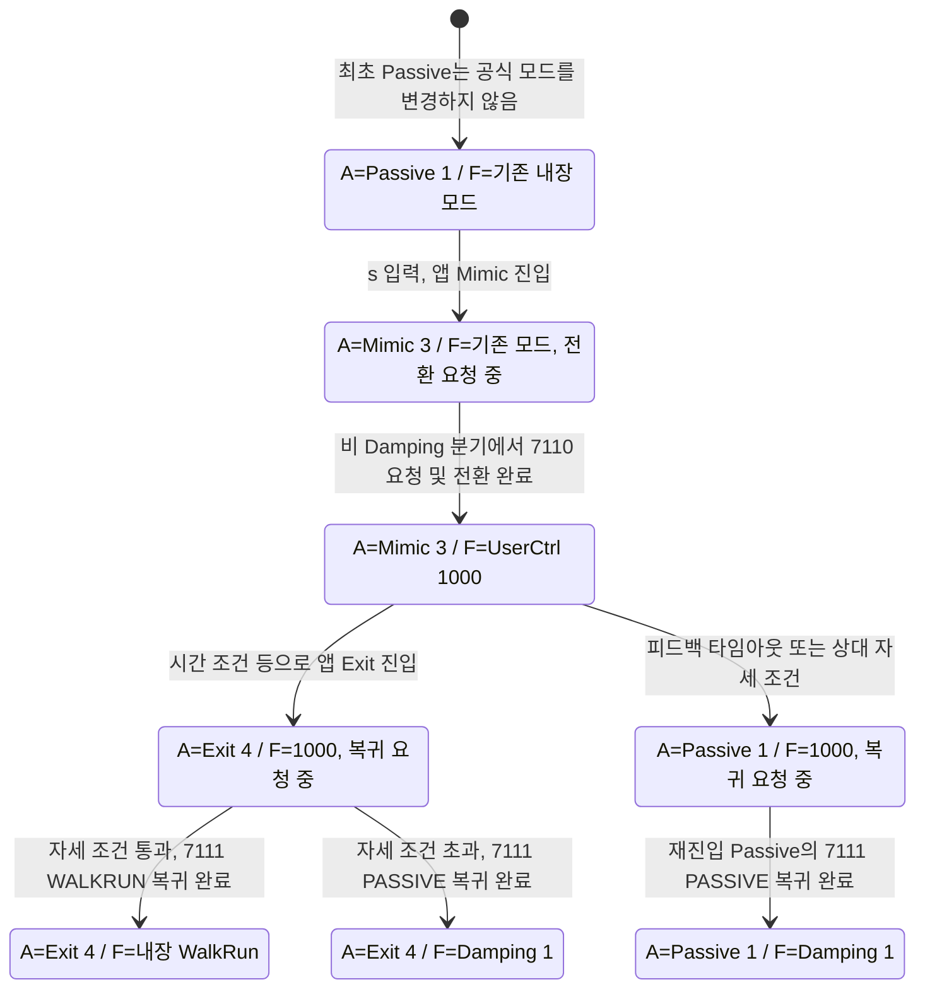
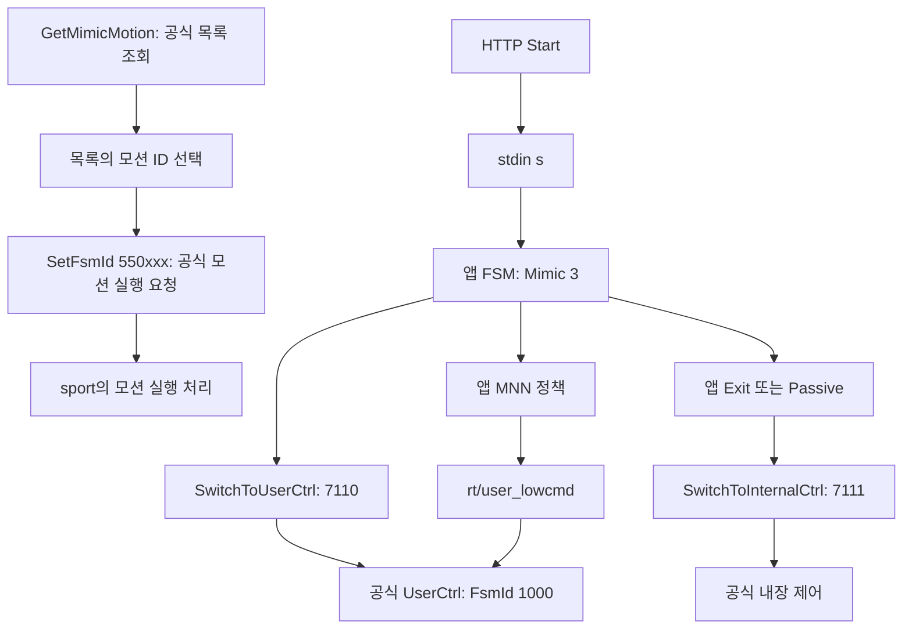

# G1 모션 선택, UserCtrl 제어권 인계와 앱 FSM의 정확한 연결

[문서 색인](README.md) · [Mimic 모션 API](g1-mimic-motion-api.ko.md) · [앱 실행 분석](g1-mimic-runtime.ko.md)

검토일: **2026-11-18, Asia/Seoul**.
공식 SDK, 앱 템플릿, 로컬 `unitree_sdk2_reversed`, 개발자 질의응답,
공개 클라이언트 구현 및 실기체 연구를 대조했다.

## 1. 결론: 같은 공식 제어 서비스에 요청하지만, 같은 기능은 아니다

**`SetFsmId(550xxx)`는 서비스가 제공하는 특정 모션의 실행 선택이고,
`SwitchToUserCtrl()`는 사용자 프로그램에 전신 관절 제어권을 인계하는 요청이다.**
두 호출 모두 공식 `sport` 서비스에 전달되지만, 지정하는 대상과 실행 책임이 다르다.
`GetMimicMotion()`은 모션 목록 조회이며, 그 자체로 앱 FSM이나 공식 모드를 전환하는 명령이 아니다.

현재 템플릿의 `SwitchToUserCtrl()`이 공식 FsmId를 바꾸는 것은 맞다.
이 앱은 전환 후 **공식 FsmId가 `1000`인지 직접 검사**한다.
그동안 **앱 내부 상태 ID는 `Mimic=3`을 유지**한다.
이 두 상태를 같은 번호 체계로 읽지 않는 것이 핵심이다.

| 비교 항목 | 공식 Mimic 모션 호출 | 현재 g1_mimic_demo |
|---|---|---|
| 실행할 대상 선택 | 공식 모션 목록의 `motion_api_id` | YAML에 고정된 정책·모션 파일 |
| 시작 입력 | `SetFsmId(550xxx)` | HTTP Start → stdin `s` |
| 제어 서비스 요청 | API `7101`에 모션 선택값 전달 | API `7110`으로 UserCtrl 진입 요청 |
| 외부 프로그램이 매 스텝 목표 관절값을 계산해야 하는가 | 이 API의 호출자에게 요구되지 않음 | MNN 정책으로 계산해야 함 |
| 호출자가 지속적으로 발행하는 관절 명령 | 모션 호출 API에는 없음 | `rt/user_lowcmd` |
| 앱 내부 FSM | 이 인터페이스에 정의되어 있지 않음 | Passive 1 → Mimic 3 → Exit 4 등 |
| 공식 FsmId와의 연결 | 복합 ID로 모션 실행을 요청 | 정상 제어 시 1000을 요구 |
| 내장 제어로의 명시적 복귀 | 공개 모션 호출 설명에 추가 절차를 요구하지 않음 | 앱이 `SwitchToInternalCtrl()` 호출 |

따라서 **“둘 다 춤을 추고 FsmId와 관련된다”와 “두 API가 같은 의미다”는 다른 주장**이다.
같은 학습 방식·비슷한 모션 데이터를 사용할 수 있다는 사실도 API의 실행 계약을 같게 만들지 않는다.
공식 모션 서비스의 내부 모터 명령 경로와, 외부 앱에 공개된 UserCtrl 경로도 구분해야 한다.

공식 모션 선택이 어떤 UniStore 설치 앱의 HTTP Start에 연결되는 별도 중계 기능은
현재 템플릿과 공개 Loco 클라이언트에 없다. 그런 연결을 주장하려면
**서비스의 모션 선택 요청을 해당 앱 실행 요청으로 변환하는 구현**이 별도로 있어야 한다.
현재 소스의 단순히 같은 `Mimic` 명칭을 그 연결의 증거로 사용할 수 없다.

근거: [공식 운동 서비스 문서][sport], [공식 LocoClient][loco],
[현재 State_Mimic.cpp](../g1_mimic_demo/deploy_template/src/State_Mimic.cpp),
[HTTP Start](../g1_mimic_demo/app/g1/cmd_server.py).

## 2. 세 상태 공간을 함께 읽는 방법

분석을 위해 다음 기호를 사용한다. SDK에 새 필드를 추가한 것이 아니다.

| 기호 | 의미 | 실제 확인 위치 |
|---|---|---|
| `A` | 현재 앱 내부 상태 | `CtrlFSM`, YAML의 상태 ID |
| `F` | 공식 제어기가 보고하는 FsmId | 성공한 `GetFsmId()` 또는 공식 상태 토픽 |
| `M` | 공식 Mimic 목록에서 선택할 모션 ID | `GetMimicMotion()`의 `motion` 키 |

예를 들어 외부 정책이 정상 실행 중이면 `(A=3, F=1000)`이다.
`M=507`은 이 앱에서 선택하는 값이 아니며, 현재 앱 설정에는 `M`을 지정하는 필드도 없다.
반대로 `SetFsmId(550507)`은 `M=507`을 선택하는 공식 모션 호출이다.
그 요청만으로 현재 템플릿의 `A`가 3으로 바뀌는 직접 경로는 없다.

`GetFsmMode()`는 `A`나 `M`을 조회하는 함수가 아니다.
현재 템플릿은 이 API를 호출하지 않으므로, 앱의 전이 조건을 공식 FsmMode 조건으로 설명하면 안 된다.

### 2.1 현재 템플릿의 결합 상태 전이도

화살표의 “완료”는 공식 서비스가 요청을 허용하고 실제 전환을 마친 경우이다.
아래 주요 경로의 출발점은 외부에서 내장 운용 모드를 준비한 경우이다.
앱 초기화 코드 자체가 그 공식 모드를 선택하거나 확인한다는 뜻은 아니다.
이 도식은 앱 상태와 공식 상태를 한 화면에서 비교하기 위해 조합한 것이며,
공식 펌웨어가 아래 이름의 결합 상태를 구현한다는 뜻은 아니다.



Exit가 `PASSIVE` 복귀를 요청했다고 앱이 즉시 Passive가 되는 것은 아니다.
공식 Damping으로 돌아갔더라도 앱은 Exit에 남을 수 있다.
이를 더 직접적으로 표현하면 아래와 같다.

| 사건 | 앱 `A` | 공식 `F` |
|---|---|---|
| Exit에서 자세 조건 초과 후 Damping 복귀 완료 | Exit 4 유지 | Damping 1 |
| Exit에서 피드백 타임아웃 | Passive 1로 전이 | 이후 Passive.enter가 Damping 복귀 요청 |

위 상태도는 주요 진입·종료 경로를 나타낸다. 진입 거부·RPC 실패 및 재시도까지 포함한
앱의 전체 전이 조건은 [실행 문서](g1-mimic-runtime.ko.md)를 함께 참고한다.

### 2.2 코드의 순서와 성공 판정

1. `CtrlFSM`이 이전 상태를 나와 `State_Mimic::enter()`를 호출한다. 이때 앱 상태는 3이다.
2. 정책 스레드가 `GetFsmId()`를 호출하고 값이 1이 아니면 `SwitchToUserCtrl()`을 요청한다.
3. 정책은 관절 목표를 계산해 발행하기 시작한다.
4. 논리 시간 0.1초 초과 후 공식 FsmId가 1000인지 검사하고 이후에도 다시 확인한다.
5. 종료 조건이 성립하면 앱 FSM이 `Mimic::exit()`를 실행해 정책 스레드를 중지·join한다.
6. 다음 앱 상태의 `enter()`에서 공식 내장 모드로 복귀를 요청한다.

이 앱의 `current_fsm_id != 1`은 **WalkRun 전체를 판별하는 조건이 아니다**.
진입·조회 RPC의 반환값도 검사하지 않으므로 “요청했다”와 “공식 전환이 완료됐다”를 구분한다.
복귀 후 FsmId를 재조회하지 않는 점도 현재 구현의 한계이다.

또한 `SwitchToInnerCtrl`는 이 SDK의 메서드 이름이 아니다.
정확한 이름은 **`SwitchToInternalCtrl(InternalFsmMode)`**이다.

근거: [CtrlFSM](../g1_mimic_demo/deploy_template/include/FSM/CtrlFSM.h),
[Mimic](../g1_mimic_demo/deploy_template/src/State_Mimic.cpp),
[Exit](../g1_mimic_demo/deploy_template/include/FSM/State_Exit.h),
[Passive](../g1_mimic_demo/deploy_template/include/FSM/State_Passive.h).

## 3. RPC 전송 단위에서 확인한 차이

### 3.1 원본 헤더를 컴파일한 격리 확인

원본 G1 Loco 헤더와 원본 SDK archive의 JSON 구현을 사용하여 호출을 컴파일했다.
DDS 연결을 수행하는 `unitree::robot::Client`만 요청을 기록하는 테스트 대역으로 치환했다.
따라서 **실제 inline 메서드의 직렬화·호출 관계를 확인하는 검사**이며,
로봇의 FSM 응답을 모의하거나 실기체 전환 성공을 측정한 검사가 아니다.

| 각각 호출한 메서드 | 서비스 | RPC API | 기록된 parameter |
|---|---|---:|---|
| `GetMimicMotion()` | sport | 7100 | `{"fsm_id":550,"api_id":1}` |
| `SetFsmId(550507)` | sport | 7101 | `{"data":550507}` |
| `SwitchToUserCtrl()` | sport | 7110 | `{"data":false}` |
| `SwitchToInternalCtrl(LAST)` | sport | 7111 | `{"data":0}` |
| `SwitchToInternalCtrl(PASSIVE)` | sport | 7111 | `{"data":1}` |
| `SwitchToInternalCtrl(WALKRUN)` | sport | 7111 | `{"data":2}` |

여섯 메서드 호출에서 여섯 RPC만 기록됐다.
모션 선택 메서드가 사용자 제어 진입·복귀 RPC를 추가 생성하지 않는다.
연결 초기화 등 실제 Client의 수명주기 통신을 포함한 패킷 수를 측정한 것은 아니다.
`7110`의 `false`는 기본 `JsonizeDataBool` 값이지, UserCtrl 진입을 취소한다는 뜻이 아니다.
진입 요청이라는 의미는 **API 7110**이 정한다.
마찬가지로 API 7111의 `2`는 공식 FsmId 2를 선택하는 요청이 아니다.

검사 입력과 결과는 [재현 절차](evidence/README.md) 및
[기록된 요청](evidence/g1-loco-rpc-trace.json)에 보존했다.

### 3.2 SDK의 “상태”와 로봇의 FSM을 혼동하지 않는다

리버싱된 `Client::Call()`은 API 등록과 lease·우선순위를 검사하고 `ClientBase::Call()`로 넘긴다.
`ClientBase`는 다음을 수행한다.

```text
API 번호·parameter로 Request 구성
→ request ID, lease, priority, noreply 설정
→ ClientStub::SendRequest
→ 응답 대기 및 API 번호 대조
→ 응답 data와 status.code 반환
```

채널 이름 생성 규칙을 따라 `sport` 요청은 `rt/api/sport/request`,
응답은 `rt/api/sport/response`에 연결된다.
이는 관절 명령 토픽 `rt/user_lowcmd`와 별개이다.

이 공통 RPC 계층의 queue·future·lease 상태가 G1의 Damping·Mimic·UserCtrl 상태는 아니다.
API를 등록하는 `LocoClient::Init()`도 G1 상태를 생성·전환하는 함수가 아니다.
사용 가능한 클라이언트 API를 등록하는 초기화이다.

근거: 복원된 [Client][rev-client], [ClientBase][rev-base], [ClientStub][rev-stub],
[ChannelNamer][rev-namer], [공식 JsonizeDataBool][json-bool].

## 4. unitree_sdk2_reversed에 실제로 있는 것과 없는 것

### 4.1 대상과 출처

로컬 디렉터리의 Git 원격은 `sparkleholic/lgrobot_sdk`이고,
분석 기준 커밋은 **`392e753457adb24d08c2c1efd09cc2112d29a953`**이다.
이는 Unitree가 공개한 G1 운동 제어기 펌웨어 저장소가 아니라,
SDK archive를 바탕으로 재구성한 별도 저장소이다.

기록상 입력은 공식 SDK 커밋 `63096d0ac0c5d2dec9d6e0c22cd5233410ca2f36`의
Linux x86-64 `libunitree_sdk2.a`이다. 직접 확인한 SHA-256도 provenance와 일치한다.

```text
08402aea74150dfbfc3fbfded4ca746916a8d892b54d2bade0cbf392a3be4029
```

### 4.2 소스·archive 양쪽 조사 결과

| 대상 | 확인 결과 | 의미 |
|---|---|---|
| 복원 CMake 및 member_sources | archive member 132개를 소스에 대응 | 복원 범위의 기준 |
| `include/.../g1_loco_client.hpp` | 공식 SDK와 동일한 inline G1 클라이언트 | 550 및 7110/7111 요청 생성 코드가 있음 |
| `src/robot/client*.cpp` | 공통 RPC 요청·응답 처리 | 로봇 운동 제어 FSM은 아님 |
| `src/robot/server*.cpp` | 범용 RPC 서버 등록·dispatch 프레임워크 | G1 sport 서비스의 handler 본문은 아님 |
| `Server::ServerRequestHandler()` | API별 등록 callback을 조회해 호출 | 개별 운동 동작은 등록된 callback이 구현해야 함 |
| `src/clients/` | Go2/B2 및 Motion Switcher 래퍼 | G1 Mimic 운동 실행기 구현 없음 |
| 원본 archive의 `ar t`, `nm -C` | 범용 Server 심벌은 있으나 대상 G1 FSM 실행기 구현 심벌은 확인되지 않음 | 단순 파일명 검색 이외에 archive도 대조 |

즉 `server.cpp`가 있다는 사실을 **로봇의 sport 서버 구현도 복원되었다**는 의미로 읽으면 안 된다.
해당 코드는 `mApiHandlerMap`에서 callback을 찾는 프레임워크이다.
소스에는 G1 전용 7100·7101·7110·7111 handler의 등록과 실행 본문이 없다.
550 모션의 모델 로딩·선택·모터 출력이나 UserCtrl 라우팅 테이블도 없다.

G1 `LocoClient` 메서드가 archive의 별도 구현 심벌로 보이지 않는 것은
공개 헤더 안에 inline으로 구현되어 있기 때문이다.
이를 G1 API가 없다는 증거로 사용하지 않았다.
반대로 그 inline 헤더에 `550`이 있다는 사실도 서버 운동 제어기를 복원했다는 증거가 아니다.

공식 SDK의 `example/state_machine/state_machine.hpp`도 대조했다.
이는 DAMPING·STAND·CTRL 및 PD 비율을 다루는 `SimpleStateMachine` 예제이고,
G1의 공식 FsmId 550·1000을 처리하는 서버가 아니다.

**따라서 이번 리버싱 소스 조사에서 확정한 것은 “공식 FSM이 없다”가 아니라,
“현재 복원 archive와 소스의 범위에 G1 운동 제어기 FSM handler 구현이 포함되어 있지 않다”이다.**
정확히 빠진 구현 경계를 식별한 것이며, 같은 검색을 더 반복하면 그 소스가 나타난다고 가정하지 않는다.

근거: [복원 provenance][rev-provenance], [archive member 대응][rev-members],
[범용 Server dispatch][rev-server], [공식 SDK의 상태 머신 예제][simple-fsm].

## 5. 개발자 질의응답·클라이언트 코드·실기체 연구 대조

### 5.1 자료별로 실제 확인되는 범위

| 자료 | 내용 | 이번 분석에 사용하는 범위 |
|---|---|---|
| 공식 Python SDK 이슈 #181, 2026-09-09 | 펌웨어 모션은 조회되지만 UniStore 추가 춤은 목록에 없다는 사용자 보고 | 설치 앱과 공식 목록을 동일시할 수 없다는 실제 반례 보고. 전체 펌웨어 규칙으로 일반화하지 않음 |
| MYBOTSHOP G1 완료 판정 질의, 2026-02 | `SetVelocity` 이후 완료·정지 확인을 질문하고 상태 관측을 제안 | RPC 응답과 실제 동작 완료의 구분. Mimic 내부 FSM에 대한 답변은 아님 |
| `lyra-fleet`의 작성자 구현 | 공식 7100 모션 목록을 파싱하고 7101로 550xxx 호출 | 실제 공개 클라이언트의 모션 실행 경로 |
| G1 실기체 연구, arXiv 2611.11127v1 | 외부 정책 제어권의 진입·복귀를 기록 | 특정 기체·펌웨어의 제어권 전환 사례 |

MYBOTSHOP은 로봇 판매·지원사의 포럼이다. 그 답변을 Unitree 펌웨어 개발자의 공식 설명으로
표시하지 않았다. 해당 포럼과 MCR의 공개 G1 포럼을 조사했지만,
이번 쟁점의 G1 550 서버 handler나 UniStore 앱 번호 매핑을 공개한 글은 확보하지 못했다.
Go1·Go2의 Dance1 또는 Debug 설명을 G1의 550/1000 전이 근거로 대체하지 않았다.

공식 SDK 이슈 #181은 검토 시점에도 댓글 0개였다.
그 질문 자체를 공식 답변으로 인용하지 않는다.

근거: [SDK 이슈 #181][issue181], [완료 판정 포럼 원문][forum-completion], [MCR 포럼][mcr].

### 5.2 실제 공개 모션 클라이언트에서의 종료 처리

`lyra-fleet` 커밋 `d18f4b420cc9ea6b28a9dc8c91addcda5e5e6b2e`의 `backend.py`는
다음 흐름을 구현한다.

```text
_discover_g1_dances()
  → sport 7100, {fsm_id:550, api_id:1}
  → motion 목록 파싱

_send_g1_switch_mode_async(mode_data)
  → sport 7101, {data:550xxx}
  → 클라이언트의 지연 작업 예약

_g1_stand_after()
  → 지연 후 sport 7101, {data:801}
```

이 파일에는 `SwitchToUserCtrl()` 또는 API 7110 호출이 없다.
특히 코드의 “자동 복귀”는 **이 클라이언트가 타이머 뒤 추가 요청을 보내는 기능**이다.
이를 펌웨어가 내부적으로 `SwitchToInternalCtrl()`을 호출했다는 증거로 읽으면 틀린다.

작성자 주석에는 기체에서 목록·시각을 확인했다고 적혀 있지만,
코드와 주석만으로 모든 실기체 전이를 독립 검증한 것은 아니다.
여기서는 호출 관계를 근거로 사용하며, 그 기체의 모션 목록과 801을 전체 로봇에 권장하지 않는다.

근거: [작성자의 backend.py][lyra].

### 5.3 제어권 복귀 뒤 SetFsmId를 별도로 호출한 실기체 사례

[2026-11-08 공개된 연구][paper]의 §7·Table 4는 G1 펌웨어 v1.5.2에서 다음을 보고한다.

- 해당 기체의 UserCtrl 진입은 Damping에서 수용됐고 501·4에서는 성공 응답에도 적용되지 않았다.
- `SwitchToInternalCtrl(WALKRUN)` 뒤 보고 상태는 802였다.
- 연구 구현은 그 뒤 `SetFsmId(501)`을 별도로 호출해 목표 내장 모드로 돌렸다.

이는 **제어권을 공식 제어기에 반환하는 요청**과 **그 안에서 목표 모드를 선택하는 요청**을
같은 프로그램이 연속해서 사용할 수 있음을 보여준다.
이 연구는 공식 `550xxx` 모션 실행기의 분석이 아니며, 현재 템플릿과도 다른 실행 구현이다.
특정 기체의 결과를 공식 매뉴얼의 모든 지원 상태를 덮어쓰는 규칙으로 일반화하지 않는다.

특히 이 결과는 현재 템플릿의 “1이면 거부” 분기와 반대되는 동작 조건이다.
따라서 템플릿의 소스 경로가 명확하다는 것과 모든 펌웨어에서 그 경로가 성공한다는 것은 다르다.
이 문서의 상태도는 그 차이를 숨기지 않는다.

## 6. 현재 확정할 수 있는 FSM 연결과 구현 경계



두 줄은 모두 `sport`의 공식 상태·제어와 관련되지만 목적이 다르다.
위쪽 모션 호출의 클라이언트는 모션 선택을 서비스에 맡긴다.
아래쪽 앱은 실행할 정책을 자신이 가지고 제어권을 요청하며 직접 모터 목표를 생성한다.
**공식 FsmId 전환이 존재한다는 점은 분명하고, 그것이 모션 ID를 선택하는 것과 같지는 않다.**

550 처리기와 UserCtrl 처리기가 서버 내부에서 공유하는 코드가 있는지는
그 handler 본문이나 실제 firmware trace가 필요한 **구현 내부의 질문**이다.
그 내부 질문과, 위에서 확정한 공개 API의 개념 차이를 혼합하지 않는다.
현재 조사로 확보하지 못한 것은 바로 그 서버 handler이며,
현재 앱의 3 → 공식 1000 연결이나 SDK의 실제 RPC 전송 경로가 아니다.

이 범위를 넘어서 자동 `550xxx → 1000 → 550xxx` 전이도를 그리는 것은
지금 확보한 공식 계약·소스·포럼 자료·실기체 연구 어느 것의 결과도 아니다.

[sport]: https://support.unitree.com/home/en/G1_developer/sport_services_interface
[loco]: https://github.com/unitreerobotics/unitree_sdk2/blob/aaf69cb56c9d5ed63d8b284008ec3a8ab999bec1/include/unitree/robot/g1/loco/g1_loco_client.hpp
[json-bool]: https://github.com/unitreerobotics/unitree_sdk2/blob/63096d0ac0c5d2dec9d6e0c22cd5233410ca2f36/include/unitree/robot/go2/public/jsonize_type.hpp
[simple-fsm]: https://github.com/unitreerobotics/unitree_sdk2/blob/63096d0ac0c5d2dec9d6e0c22cd5233410ca2f36/example/state_machine/state_machine.hpp
[rev-client]: https://github.com/sparkleholic/lgrobot_sdk/blob/392e753457adb24d08c2c1efd09cc2112d29a953/src/robot/client.cpp
[rev-base]: https://github.com/sparkleholic/lgrobot_sdk/blob/392e753457adb24d08c2c1efd09cc2112d29a953/src/robot/client_base.cpp
[rev-stub]: https://github.com/sparkleholic/lgrobot_sdk/blob/392e753457adb24d08c2c1efd09cc2112d29a953/src/robot/client_stub.cpp
[rev-namer]: https://github.com/sparkleholic/lgrobot_sdk/blob/392e753457adb24d08c2c1efd09cc2112d29a953/src/robot/channel_namer.cpp
[rev-server]: https://github.com/sparkleholic/lgrobot_sdk/blob/392e753457adb24d08c2c1efd09cc2112d29a953/src/robot/server.cpp
[rev-provenance]: https://github.com/sparkleholic/lgrobot_sdk/blob/392e753457adb24d08c2c1efd09cc2112d29a953/provenance/reconstruction.md
[rev-members]: https://github.com/sparkleholic/lgrobot_sdk/blob/392e753457adb24d08c2c1efd09cc2112d29a953/provenance/member_sources.json
[issue181]: https://github.com/unitreerobotics/unitree_sdk2_python/issues/181
[forum-completion]: https://forum.mybotshop.de/t/unitree-g1-how-to-detect-motion-command-completion-with-g1-lococlient-apis/1702
[mcr]: https://mcrcomputing.com/unitree-g1-forum/
[lyra]: https://github.com/wangxiangji666-gif/lyra-fleet/blob/d18f4b420cc9ea6b28a9dc8c91addcda5e5e6b2e/backend.py#L2004-L2078
[paper]: https://arxiv.org/html/2611.11127v1#S7
