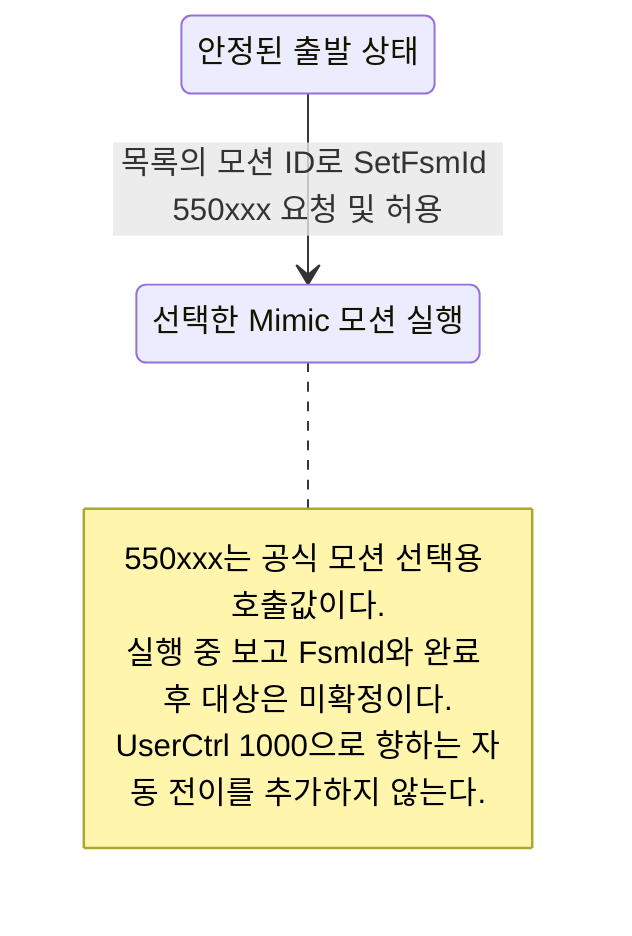
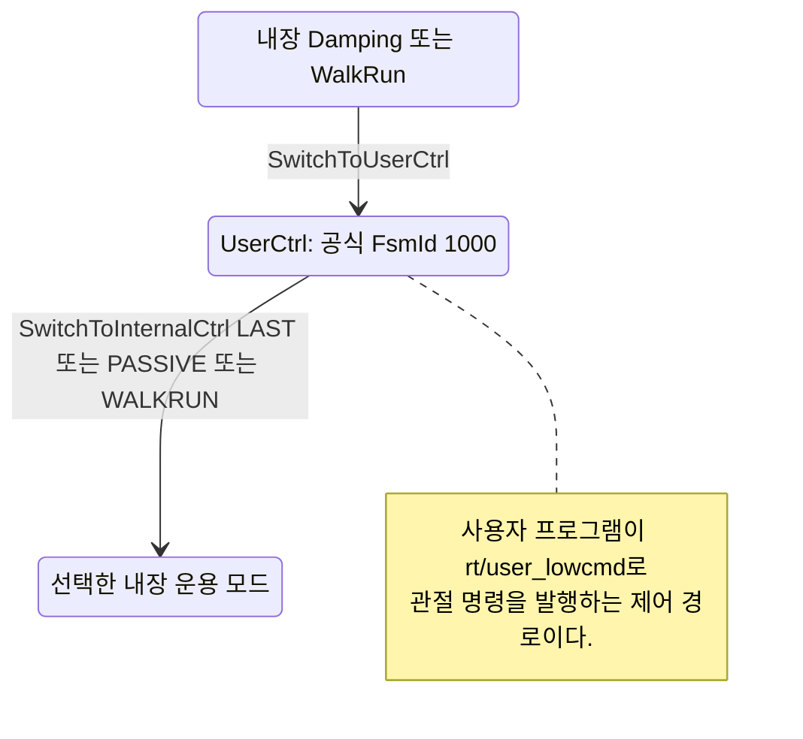
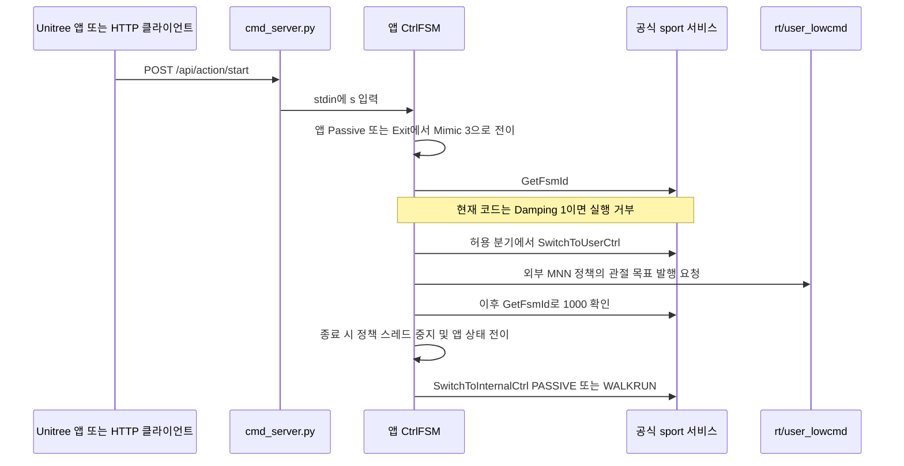

# 공식 Mimic 모션 API, 550 접두사와 UserCtrl의 관계

[문서 색인](README.md) · [공식 제어 개념](g1-control-concepts.ko.md) · [앱 실행 구조](g1-mimic-runtime.ko.md)

검토일: **2026-11-18, Asia/Seoul**.
이 문서는 [공식 영문 문서][sport]·[중문 문서][sport-zh], 로컬 공식 SDK, 검토 시점의 공식 SDK 원격 main,
현재 앱 템플릿을 대조한 결과이다. 로봇에서 모션을 실행하거나 상태 값을 실측하지 않았다.

## 1. 질문에 대한 판정

**`550` 접두사와 개별 모션 ID를 결합해 `SetFsmId()`로 모션을 호출하는 인터페이스는 실제로 존재한다.**
공식 용어는 `app_id`가 아니라 **모션 API ID**, SDK 주석의 표기로는 **`motion_api_id`**이다.
공식 문서와 SDK가 드는 구체적인 예는 `507 → 550507`이다.

다만 이 사실만으로 “해당 호출이 자동으로 UserCtrl 1000으로 전환한 뒤 원래 상태로 복귀한다”는
전체 실행 구조까지 확인되는 것은 아니다. 공개 문서는 모션 호출과 사용자 제어권 전환을
별도 인터페이스로 설명한다. 현재 앱 템플릿의 실제 경로도 별개이다.

| 검토한 주장 | 판정 | 근거·적용 범위 |
|---|---|---|
| Mimic 모션 인터페이스에 `550` 식별값·접두사가 있다 | 확인 | `GetMimicMotion()` 및 공식 Dance Mode 설명 |
| `550`과 개별 모션 ID를 이어 모션을 실행한다 | 확인 | 공식 예시 `SetFsmId(550507)` |
| 접미사는 UniStore의 `app_id`이다 | 확인되지 않음 | 공개 인터페이스는 `motion_api_id`로 정의 |
| `SetFsmId(550501)`은 유효한 모션 실행 요청일 수 있다 | 조건부 확인 | 실제 모션 목록에 `501`이 있어야 해당 모션을 선택하는 값이 됨 |
| 모든 G1에 모션 `501`이 존재한다 | 보장되지 않음 | 현재 로봇의 목록을 조회해야 함 |
| 요청값 `550501`은 실행 중 항상 `GetFsmId()`로도 보고된다 | 확인되지 않음 | 모션 호출 인코딩과 상태 보고 값의 대응표가 없음 |
| 모션 호출 후 자동으로 `SwitchToUserCtrl()`이 실행된다 | 확인되지 않음 | 클라이언트에는 그런 호출 연결이 없고 서버 내부 구현은 공개되지 않음 |
| 실행 중 공식 FsmId는 반드시 `1000`이 된다 | 확인되지 않음 | 공식 모션 실행과 UserCtrl의 동등성을 명시하지 않음 |
| `SwitchToInternalCtrl()`로 모션을 재개한다 | 확인되지 않음 | 문서상 내장 운용 모드 복귀이며 모션 재개 API가 아님 |
| 현재 템플릿은 `550xxx`로 시작한다 | 소스와 다름 | HTTP의 `s` 입력에서 앱 Mimic으로 전이하고 직접 UserCtrl 요청 |

따라서 결론은 **복합 호출 ID 규칙은 사실이고, 제시된 전체 자동 전환 시퀀스는 공개 근거로 확정되지 않는다**이다.
서버가 내부적으로 어떤 코드를 재사용할 가능성까지 부정하는 결론은 아니다.
확인되지 않은 구현을 공식 동작 계약이나 현재 템플릿의 구현으로 기록하지 않는다는 뜻이다.

근거: [공식 운동 서비스 문서의 Dance Mode 절][sport], [공식 LocoClient][loco],
[UniStore 전환 매뉴얼][switch], [현재 State_Mimic.cpp](../g1_mimic_demo/deploy_template/src/State_Mimic.cpp).

## 2. 확인한 버전과 누락 내용의 정정

| 확인 대상 | 기준 |
|---|---|
| 공식 SDK 원격 main | `aaf69cb56c9d5ed63d8b284008ec3a8ab999bec1` |
| 로컬 공식 SDK | `63096d0ac0c5d2dec9d6e0c22cd5233410ca2f36` |
| GetMimicMotion 도입 커밋 | `69c04316d81ac244c314e730106e24787b3e61b8`, 2026-08-17 |
| 앱의 실행 소스 기준 | `1a16513b8a57d76708ffd2854fe2a73c090cced1` |
| 공식 웹 문서 | 영문·중문 운동 서비스의 Dance Mode 절, UniStore 전환 매뉴얼 |

원격 main은 `git ls-remote`로 확인하고 해당 커밋에 고정된 다음 네 파일을 가져와
로컬 SDK와 대조했다. 내용은 동일했다.

- `include/unitree/robot/g1/loco/g1_loco_client.hpp`
- `include/unitree/robot/g1/loco/g1_loco_api.hpp`
- `example/g1/high_level/g1_loco_client_example.cpp`
- `example/g1/high_level/g1_userctrl_dds_example.cpp`

즉 `GetMimicMotion()`은 새로 내려받아야만 발견되는 기능이 아니라 이전 분석에 사용한
로컬 SDK에도 이미 있었다. 최초 문서는 Expert Interface의 기본 모드 표만 다루어
이 모션별 호출 규칙을 누락했다. 이번 수정은 그 누락을 보완한 것이다.

반면 앱 템플릿이 자체 복사한 Loco 헤더에는 이 추가 기능이 없다.
공식 SDK의 기능과 현재 앱이 실제 사용하는 헤더를 같은 것으로 취급하면 안 된다.

근거: [기능 도입 커밋][introduced], [공식 API 헤더][api],
[템플릿 LocoClient](../g1_mimic_demo/deploy_template/include/unitree/robot/g1/loco/g1_loco_client.hpp).

## 3. GetMimicMotion: 사용 가능한 모션 목록 조회

### 3.1 요청 경로와 숫자의 의미

```text
GetMimicMotion(data)
  → _fsm_api(parameter, data)
  → sport 서비스의 RPC API 7100

parameter = {"fsm_id": 550, "api_id": 1}
```

다음 번호들은 각각 다른 범위에 속한다.

| 값·필드 | 의미 |
|---|---|
| RPC API `7100` | SDK의 `ROBOT_API_ID_LOCO_FSM_API` |
| JSON `fsm_id=550` | 이 요청에서 Mimic을 지정하는 값 |
| JSON `api_id=1` | `GetMimicMotion()`이 사용하는 내부 요청 선택값 |
| 응답 `motion`의 키 | 개별 모션의 `motion_api_id` |
| RPC API `7101` | `SetFsmId()`가 사용하는 별도의 모드·모션 요청 API |

`api_id=1`을 모션 번호 `1`이나 앱 번호 `1`로 읽으면 안 된다.
같은 JSON에 들어 있다는 이유로 `fsm_id`, `api_id`, `motion_api_id`가 같은 종류의 ID인 것도 아니다.
목록 조회 자체는 `SetFsmId(550)`을 실행하는 호출이 아니다.

### 3.2 응답 구조

SDK 주석과 공식 문서가 정의한 구조를 JSON 형식으로 표현하면 아래와 같다.
`0.0`과 `example_motion`은 형식 설명용 값이며 실제 기체 응답이 아니다.

```json
{
  "fsm_id": 550,
  "api_id": 1,
  "motion": {
    "507": {
      "duration": 0.0,
      "name": "example_motion"
    }
  }
}
```

`motion`의 키는 JSON 문자열이다. 공식 SDK 주석은 이 키를 `motion_api_id`라고 부른다.
각 항목의 `duration`은 float, `name`은 string이다.
분석한 공개 인터페이스는 `duration`의 단위를 별도 명시하지 않으므로,
이 문서에서 임의의 대기 시간·완료 판정 규칙으로 사용하지 않는다.

응답은 **현재 로봇의 사용 가능한 모션 목록**이다.
SDK 파일에 모든 모션 ID와 이름의 고정 목록이 들어 있는 구조는 아니다.
주석의 `507`은 공식 예시이며 모든 로봇이 해당 항목을 갖는다는 보장은 아니다.

### 3.3 공식 CLI 예제의 정확한 옵션 문법

공식 CMake 타깃 `g1_loco_client`가 빌드되어 있고 로봇 네트워크가 구성된 환경에서는
목록 조회 옵션을 사용할 수 있다. NIC 이름 `eth0`는 예시이다.
이 메서드의 공식 설명도 기립과 같은 안정된 상태를 전제로 한다.

```bash
./g1_loco_client --network_interface=eth0 --get_mimic_motion
```

공식 C++ 예제의 파서는 값이 있는 인자를 `--key=value`로 읽는다.
따라서 문서 주석에서 간략히 보이는 `--set_fsm_id 550507`을 이 예제에 그대로 복사하면
동일하게 파싱되지 않는다. 예제 실행 문법은 `--set_fsm_id=550507`이다.

예제는 `GetMimicMotion()`의 반환값을 검사하지 않고 결과 문자열을 출력한다.
실제 확인 프로그램에서는 RPC 반환값을 먼저 확인해야 한다.
문자열이 비어 있는 이유를 무조건 “등록된 모션이 없음”으로 판단하면 안 된다.

근거: [LocoClient 구현][loco], [Loco CLI 예제][cli], [공식 API 번호][api], [CMake 실행 타깃][cmake].

## 4. SetFsmId로 개별 모션 실행 요청

### 4.1 결합 규칙

공식 문서의 정의는 **접두사 `550`과 모션 API ID를 이어 붙이는 것**이다.

| 목록에서 선택한 모션 API ID | SetFsmId에 전달할 값 | 적용 조건 |
|---|---:|---|
| `507` | `550507` | 공식 문서와 SDK의 예시 |
| `501` | `550501` | 해당 로봇의 모션 목록에 `501`이 있는 경우 |

예를 들어 목록에서 `507`을 확인한 뒤 호출하는 API는 다음과 같다.

```cpp
const int32_t ret = client.SetFsmId(550507);
```

메서드 이름은 `FsmId(...)`가 아니라 `SetFsmId(...)`이다.
SDK는 이 정수를 JSON `{"data":550507}` 형태로 직렬화하여 API `7101`로 보낸다.
SDK의 이 함수가 접두사를 분해하거나 모션 모델을 실행하지는 않는다.
모션 해석과 실행은 요청을 수신한 로봇 측 서비스의 영역이다.

세 자리 모션 ID 예시에서는 `550 * 1000 + motion_id`와 숫자가 같지만,
공개된 일반 규칙은 접두사 결합이다. 다른 길이의 ID·선행 0·범위까지 별도 근거 없이
고정 폭 정수 규칙으로 확장하지 않는다. 다른 공식 FsmId 전체에도 같은 결합 규칙을 적용하지 않는다.

공식 문서는 실행 전에 로봇이 기립과 같은 안정된 상태에 있어야 한다고 명시한다.
`FsmMode=0` 하나만 확인하면 모든 모션의 모든 시작 조건이 충족된다는 뜻은 아니다.

### 4.2 호출값과 보고 상태를 분리한다

`550507`은 **특정 모션을 선택하는 요청값**으로 공식 문서에서 확인된다.
다음 명제는 별도 검증이 필요하다.

- 동작 중 `GetFsmId()`가 계속 `550507`을 반환한다.
- 내부 기본 상태 `550`을 반환한다.
- 동작 중 `1000`을 반환한다.
- 완료 후 특정 이전 FsmId를 자동으로 복원한다.

공개 API는 이 네 가지 중 어떤 상태 보고 시퀀스가 실제 구현인지 정의하지 않는다.
따라서 `SetFsmId()`의 입력을 `GetFsmId()`의 필수 출력으로 단정하거나,
같은 값이 돌아오지 않았다고 즉시 모션 실패로 판단하는 확인 코드를 제시하지 않는다.

RPC 성공 여부, 목록에 있는 모션인지, 상태 보고와 실제 동작을 각각 확인해야 한다.
공개 인터페이스에 모션별 완료·중단·재개 계약이 충분히 정의되어 있지 않으므로
일반적인 UserCtrl 종료 API를 모션 정지·재개 API로 임의 대체하지 않는다.

근거: [공식 Dance Mode 정의][sport], [SetFsmId 직렬화 구현][loco].

### 4.3 501이 여러 곳에 나타날 때

| 표현 | 해석 |
|---|---|
| `SetFsmId(501)` | 공식 기본 모드 표의 Walk Motion–3DoF-waist 선택 |
| `motion` 목록의 키 `"501"` | 그 로봇의 개별 Mimic 모션 식별자. 존재 여부는 조회 필요 |
| `SetFsmId(550501)` | 위 모션 `501`을 선택하는 복합 호출값 |
| UniStore의 어떤 앱 번호가 `501`인 경우 | 공개 SDK의 모션 ID와 같다는 대응 관계는 확인되지 않음 |

숫자의 끝 세 자리가 같다고 해서 그 모션이 FsmId 501의 운용 제어기를 사용하거나,
복귀 대상을 501로 인코딩한다는 뜻은 아니다. 접미사는 공식 정의상 **선택할 모션의 ID**이다.

## 5. 상태 전이도: 공식 모션 호출과 외부 정책 실행

### 5.1 공식 Mimic 모션 호출 경로

아래는 공개 인터페이스에서 확인되는 요청과 실행 단계를 나타낸다.
펌웨어 내부 FSM의 완전한 상태 전이도가 아니다.



이 경로에서 사용자가 호출하도록 공식 문서가 안내하는 실행 API는 `SetFsmId()`이다.
매번 추가로 `SwitchToUserCtrl()`을 호출해야 한다는 설명은 없다.
추가 호출이 필요 없다는 사용자 인터페이스 설명과, 서버 내부에 UserCtrl 관련 코드가
전혀 없다는 구현 주장은 서로 다르다. 후자는 공개 자료만으로 판단할 수 없다.

### 5.2 명시적인 UserCtrl 외부 제어 경로

아래는 공식 UniStore 전환 매뉴얼이 설명하는 별도 경로이다.
각 전이는 요청이 허용되고 실제 완료된 경우이다.



SDK의 `SwitchToUserCtrl()`은 API `7110`, `SwitchToInternalCtrl(mode)`는 API `7111`이다.
각 함수는 해당 RPC를 보내며 `GetMimicMotion()`이나 `SetFsmId(550xxx)`를 내부 호출하지 않는다.
반대로 `GetMimicMotion()`과 `SetFsmId()`도 이 전환 메서드들을 내부 호출하지 않는다.
이는 **공개 클라이언트의 호출 관계**에 대한 확인이며 서버 내부 동작에 대한 증명은 아니다.

공식 C++ UserCtrl DDS 예제도 Damping에서 시작해 직접 `SwitchToUserCtrl()`을 요청하고
사용자 관절 명령을 보낸 후 `SwitchToInternalCtrl(LAST)`로 복귀한다.
이 예제에는 `550` 모션 호출이 없다.

### 5.3 현재 앱 템플릿의 실제 연결



그림은 현재 템플릿의 주된 경로를 요약한다.
피드백 타임아웃·상대 자세 이상에서는 앱 Passive로, 시간 종료·전환 실패에서는 주로 Exit로 간다.
명령 발행이 UserCtrl 확인보다 먼저 시작되는 문제와 반환값 검사 누락은
[실행 문서](g1-mimic-runtime.ko.md)의 설명을 그대로 적용한다.

이 경로에는 다음 단계가 없다.

- 공식 모션 목록을 조회하여 `motion_api_id`를 선택하는 단계.
- `SetFsmId(550501)` 또는 다른 `550xxx`로 앱을 시작하는 단계.
- 종료 후 `550501`을 다시 요청하거나 해당 모션을 재개하는 단계.

SDK의 메서드 이름이 같거나 두 구현 모두 Mimic이라고 불린다는 사실만으로,
공식 모션 실행 서비스가 이 Python 서버를 호출한다고 연결할 수는 없다.

근거: [UserCtrl 공식 예제][user-example], [공식 전환 매뉴얼][switch],
[State_Mimic.cpp](../g1_mimic_demo/deploy_template/src/State_Mimic.cpp),
[State_Exit.h](../g1_mimic_demo/deploy_template/include/FSM/State_Exit.h),
[State_Passive.h](../g1_mimic_demo/deploy_template/include/FSM/State_Passive.h),
[cmd_server.py](../g1_mimic_demo/app/g1/cmd_server.py).

## 6. 기존 FsmId로 복귀한다는 표현의 정확한 범위

`SwitchToInternalCtrl()`은 분석한 SDK에서 인자를 생략할 수 없는 메서드이다.
어디로 돌아갈지 `InternalFsmMode`를 지정해야 한다.

| 인자 | 전송값 | 문서상 복귀 대상 |
|---|---:|---|
| `LAST` | `0` | UserCtrl 진입 전의 내장 운용 모드 |
| `PASSIVE` | `1` | Damping |
| `WALKRUN` | `2` | 보행·주행 운용 모드 |

“기존 상태”가 UserCtrl 진입 전의 내장 운용 모드를 뜻한다면 `LAST`에 대한 설명과 맞는다.
그러나 기존 복합 모션 요청값을 저장했다가 재호출하거나, 그 모션의 재생 시점을 보존한다는
설명은 아니다. `LAST`의 RPC는 이전 숫자 FsmId를 인자로 보내지도 않는다.

또한 “550 모션 호출 전의 모드”와 “UserCtrl 진입 직전의 모드”는 동일하다고 가정할 수 없다.
두 사건 사이의 상태 보고와 서버 전환을 확인하지 않고 같은 복귀 대상을 가리킨다고 단정하면 안 된다.
현재 템플릿은 애초에 `LAST`를 사용하지 않고 `PASSIVE` 또는 `WALKRUN`을 명시한다.

## 7. UniStore 앱과 공식 모션 목록의 관계

공식 모션 조회 응답에는 `app_id`, 패키지 경로, HTTP 엔드포인트 또는 컨테이너 식별자가 없다.
이 사실만으로 모든 UniStore 설치 앱이 `550xxx` 모션으로 등록된다고 설명할 수 없다.
반대로 어떤 펌웨어에서도 UniStore 모션을 노출할 수 없다고 단정할 근거도 부족하다.

공식 SDK 저장소의 [Python SDK 이슈 #181][issue181]에는 2026-09-09에
“펌웨어에 포함된 모션만 조회되고 UniStore에서 추가한 춤은 반환되지 않는다”는 사용자 관찰이 있다.
2026-11-18 조회 시 공식 답변이나 추가 댓글은 없었다.
이는 해당 사용자의 환경에 대한 일차 보고이며, 전체 기체·펌웨어에 대한 공식 지원 계약은 아니다.

따라서 이 문서는 다음을 구분한다.

1. **공식 계약**: 현재 로봇의 Mimic 모션 목록을 조회하고 목록의 모션 ID로 실행 요청할 수 있다.
2. **현재 템플릿 구현**: HTTP 시작 입력으로 외부 정책을 실행하고 UserCtrl 제어권을 사용한다.
3. **미확정 연결**: 특정 UniStore 앱이 공식 모션 목록에 어떤 방식으로 등록·매핑되는지.

`app_id=501`이라는 이름을 새로 만들거나 앱의 YAML ID·HTTP 옵션 ID를 공식 모션 ID로
대입해서는 안 된다. 실제 설치 앱과 조회 결과의 관계가 필요하면 대상 펌웨어의 등록 규칙이나
Unitree의 명시적인 대응 자료가 추가로 필요하다.

## 8. 추가 실측이 필요한 항목과 이번 검토 범위

공개 자료로 확인한 사실과 실제 로봇의 동작을 연결하려면 다음 정보가 필요하다.

| 대상 | 확인할 내용 |
|---|---|
| 기체·펌웨어 | 모델, 자유도, 시스템·운동 제어기 버전 |
| 모션 목록 | 성공한 `GetMimicMotion()` 응답의 ID, 이름, 기간 필드 |
| 모션 요청 | 선택한 ID와 `SetFsmId()`의 RPC 반환값 |
| 실행 중 상태 | `GetFsmId()`·`GetFsmMode()`의 반환값과 출력값을 시간순 기록 |
| DDS 상태 | 사용 가능한 `rt/sportmodestate`와 `rt/lowstate`의 상태 보고 |
| 종료·복귀 | 모션 종료 후 실제 공식 상태, 외부 제어 시 선택한 복귀 인자 |

이 관측만으로 비공개 서버가 정확히 어느 내부 함수를 호출했는지까지 입증되지는 않는다.
특히 실제 FsmId가 1000으로 관찰되더라도 내부에서 C++ 클라이언트 메서드
`SwitchToUserCtrl()`를 호출했다는 구현 증거와는 구분해야 한다.

이번 작업에서는 위의 로봇 실측을 수행하지 않았다.
문서의 변경 범위는 공식 모션 API의 누락 보완, 이름·호출값·상태 보고의 구분,
현재 템플릿과의 연결 설명 및 공개 근거로 확정할 수 없는 시퀀스의 명시이다.

[sport]: https://support.unitree.com/home/en/G1_developer/sport_services_interface
[sport-zh]: https://support.unitree.com/home/zh/G1_developer/sport_services_interface
[switch]: https://unistore.unitree.com/manuals?slug=switch-sdk2
[loco]: https://github.com/unitreerobotics/unitree_sdk2/blob/aaf69cb56c9d5ed63d8b284008ec3a8ab999bec1/include/unitree/robot/g1/loco/g1_loco_client.hpp
[api]: https://github.com/unitreerobotics/unitree_sdk2/blob/aaf69cb56c9d5ed63d8b284008ec3a8ab999bec1/include/unitree/robot/g1/loco/g1_loco_api.hpp
[cli]: https://github.com/unitreerobotics/unitree_sdk2/blob/aaf69cb56c9d5ed63d8b284008ec3a8ab999bec1/example/g1/high_level/g1_loco_client_example.cpp
[cmake]: https://github.com/unitreerobotics/unitree_sdk2/blob/aaf69cb56c9d5ed63d8b284008ec3a8ab999bec1/example/g1/CMakeLists.txt
[user-example]: https://github.com/unitreerobotics/unitree_sdk2/blob/aaf69cb56c9d5ed63d8b284008ec3a8ab999bec1/example/g1/high_level/g1_userctrl_dds_example.cpp
[introduced]: https://github.com/unitreerobotics/unitree_sdk2/commit/69c04316d81ac244c314e730106e24787b3e61b8
[issue181]: https://github.com/unitreerobotics/unitree_sdk2_python/issues/181
