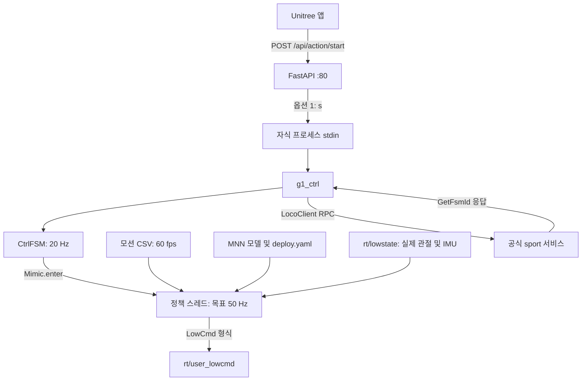
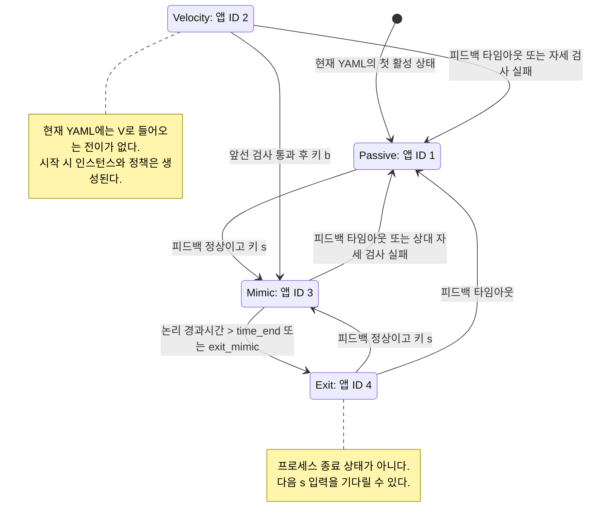
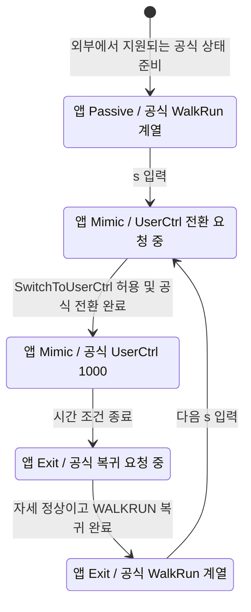
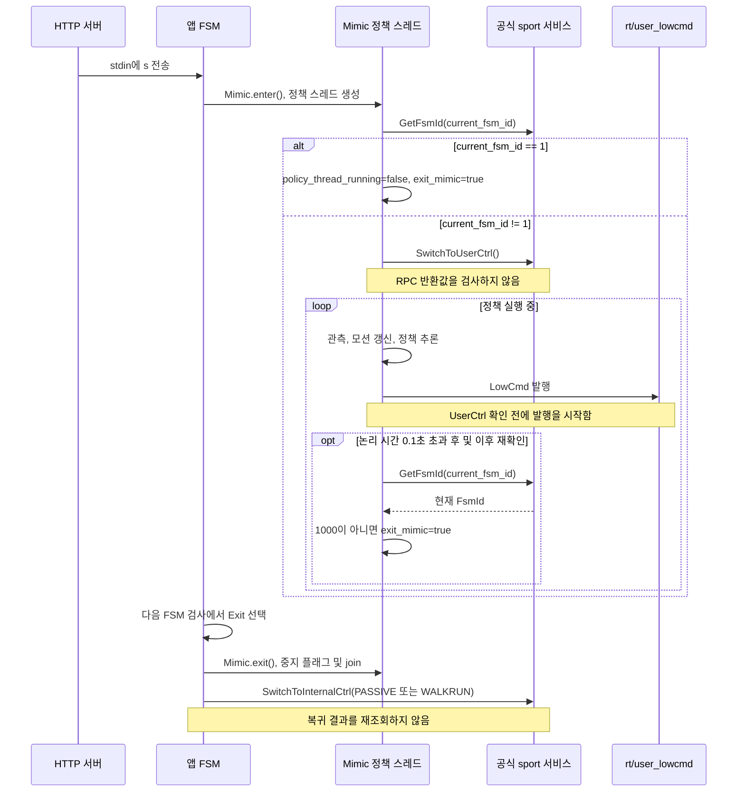
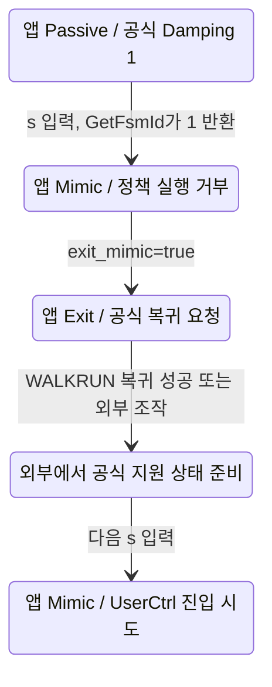
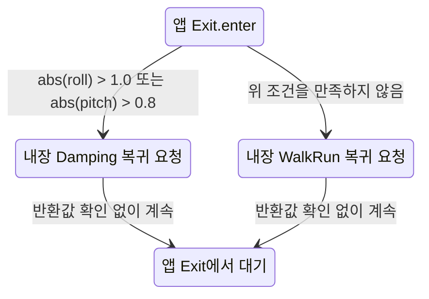

# g1_mimic_demo 실행 구조와 상태 전이

[문서 색인](README.md) · [공식 제어 개념](g1-control-concepts.ko.md) · [빌드 및 배포](g1-build-and-deploy.ko.md)

이 문서는 현재 **소스와 설정을 함께** 기준으로 삼는다. 저장소에 포함된 실행 파일이
이 소스를 그대로 빌드한 결과라는 가정은 하지 않는다. 포함된 파일과 소스의 차이는
[빌드 문서](g1-build-and-deploy.ko.md)에 별도로 설명한다.

## 1. 이 앱은 무엇을 하는가

`g1_mimic_demo`는 G1의 전신 모션 추종 정책을 실행하는 UniStore 앱 템플릿이다.
HTTP 요청을 받은 Python 서버가 C++ 프로그램의 표준 입력에 `s`를 쓰고,
C++ 프로그램이 참조 모션 CSV, 신경망 모델, 실제 로봇의 관절·IMU 상태를 사용하여
29개 관절의 목표 위치를 계산한다. 명령은 `rt/user_lowcmd`로 발행한다.

단순히 CSV의 관절 각도를 시간순으로 전송하는 플레이어가 아니다.
참조 모션과 실제 관측값을 정책 입력으로 만들고, 정책의 출력을 변환한 목표 위치를 보낸다.
저장소의 `isaaclab` 디렉터리는 이 추론 경로를 구현하는 C++ 보조 코드이다.
실행 중 Isaac Sim이나 학습 환경을 구동한다는 의미가 아니다.

현재 설정의 주된 실행 경로는 `Passive → Mimic → Exit`이다.
Velocity 정책도 초기화하지만, 현재 입력·전이 설정에는 Velocity로 들어가는 경로가 없다.
소스에 클래스가 존재하는 것과 사용자가 실행할 수 있는 기능인 것은 구분해야 한다.

## 2. 디렉터리와 구성 요소

아래 경로의 기준은 `g1_mimic_demo/`이다.

| 경로 | 역할 |
|---|---|
| `metadata.yaml` | UniStore 런타임 이미지, 권한, Python 의존성 설치와 시작 명령 |
| `app/g1/cmd_server.py` | FastAPI 서버, HTTP 명령을 실행 옵션으로 변환 |
| `app/g1/config.py` | 실행 스크립트 절대 경로, REALTIME, 옵션 ID |
| `app/g1/cmd_realtime.py` | 장기 실행 자식 프로세스 생성, 표준 입력과 출력 큐 |
| `app/g1/run_g1_ctrl.sh` | `taskset -c 4-7`로 배포된 C++ 프로그램 실행 |
| `app/g1/app_out/` | 배포용 실행 파일, 설정·정책·모션, 공유 라이브러리 |
| `deploy_template/main.cpp` | DDS 초기화, 기체 구성 확인, 앱 FSM 시작 |
| `deploy_template/include/FSM/` | 앱 FSM 프레임워크와 Passive, Exit, RLBase 등 |
| `deploy_template/src/State_Mimic.cpp` | 모션 관측값, 정책 스레드, UserCtrl 진입·확인 |
| `deploy_template/config/` | 빌드 산출물에 복사할 기준 설정과 모델 |
| `deploy_template/include/unitree/` | 일부 SDK 헤더를 같은 include 경로에서 재정의한 로컬 헤더 |



이 다이어그램에서 HTTP는 관절 목표를 주기적으로 전달하는 통신 경로가 아니다.
정책의 주기적 추론과 DDS 발행은 C++ 프로세스 내부에서 진행된다.

## 3. Python 서버와 g1_ctrl의 관계

### 3.1 시작 순서

메타데이터의 시작 명령은 다음과 같다.

```text
python3 /workspace/app/g1/cmd_server.py
```

`cmd_server.py`를 이 명령으로 실행하면 `__main__`에서 다음 순서로 진행한다.

1. `REALTIME=True`를 확인한다.
2. `start_realtime([])`로 C++ 실행 스크립트를 먼저 시작한다.
3. 출력 큐를 즉시 한 번 읽는다.
4. Uvicorn을 `0.0.0.0:80`에서 시작한다.

자식 프로세스 호출 경로는 다음과 같다.

```text
cmd_server.py
  → stdbuf -oL -eL /workspace/app/g1/run_g1_ctrl.sh
    → taskset -c 4-7 ./g1_ctrl
```

`run_g1_ctrl.sh`는 자신의 위치를 기준으로 `app_out/bin/`으로 이동한다.
서버가 시작될 때 C++ 프로그램도 시작되지만, 이 시점에 모션 정책을 실행하는 것은 아니다.
기체 연결과 모든 활성 상태의 초기화를 마친 후 앱의 최초 상태인 Passive에서 기다린다.
HTTP 포트가 열렸다는 사실만으로 C++ 초기화나 제어권 확보가 완료되었다고 판단할 수 없다.

### 3.2 HTTP 엔드포인트의 실제 동작

| 메서드·경로 | 현재 동작 |
|---|---|
| `POST /api/action/start` | 옵션 ID 1을 찾아 `s`를 자식 프로세스에 전송 |
| `POST /api/action/stop` | 옵션 ID 2를 찾지만 현재 OPTIONS에는 없으므로 오류 JSON 반환 |
| `POST /api/execute` | JSON의 `id`에 해당하는 옵션 실행 |
| `GET /api/options` | 현재 OPTIONS 반환. 실제 활성 옵션은 Start 하나 |
| `POST /api/command` | `subprocess.run()`으로 별도의 일회성 실행 경로 사용 |

현재 `config.py`의 활성 옵션은 이것뿐이다.

```python
OPTIONS = [
    {"id": 1, "name": "Start", "cmd": "s", "args": []},
]
```

Stop의 `o` 옵션은 주석 처리되어 있고, C++의 활성 상태 전이에도 `o` 처리 조건이 없다.
따라서 현재 `/api/action/stop`은 경로가 선언되어 있다는 사실과 달리 **모션을 정지시키지 않는다**.
현재 반환값은 `{"error": "Unknown action id=2"}`이다.
별도의 HTTP 오류 상태 코드를 지정하지 않아 일반적인 JSON 응답으로 반환된다.

`send_input_realtime()`은 전달된 목록의 각 문자열을 차례로 stdin에 쓰고 flush한다.
현재 Start는 목록 `["s"]`이므로 단일 `s`가 전달된다. 줄바꿈으로 구분한 관절 명령 프로토콜은 아니다.
출력 수집 스레드는 stdout과 stderr를 큐에 모으고 `read_output()`은 그 순간의 큐를 비운다.
`realtime_sent` 응답은 입력을 전송했다는 뜻이며, UserCtrl 진입이나 모션 완료를 확인한 응답이 아니다.

`/api/command`는 REALTIME 여부와 무관한 별도 호출이다. 장기 실행 프로그램을 이 경로에서
실행하면 `subprocess.run()`이 완료를 기다리며, 기존 프로세스와 별개의 제어 프로세스를 만들 수 있다.
현재 Start 흐름의 동등한 대체 API로 설명하면 안 된다.

근거: [cmd_server.py](../g1_mimic_demo/app/g1/cmd_server.py),
[config.py](../g1_mimic_demo/app/g1/config.py),
[cmd_realtime.py](../g1_mimic_demo/app/g1/cmd_realtime.py),
[실행 스크립트](../g1_mimic_demo/app/g1/run_g1_ctrl.sh).

## 4. C++ 초기화와 DDS 경로

### 4.1 main의 순서

1. `param::helper()`가 실행 파일 위치를 확인하고 YAML 및 CLI 옵션을 읽는다.
2. DDS Domain 0으로 `ChannelFactory::Init(0, network)`를 실행한다.
3. 임시 `subscription::LowCmd`를 생성하고 약 0.2초 대기한다.
4. 실제 발행 객체 `LowCmd_t`와 피드백 구독 객체 `LowState_t`를 생성한다.
5. `rt/lowstate` 연결을 기다린다.
6. 발행할 `mode_machine=5`를 설정하고 실제 기체와 일치하는지 확인한다.
7. YAML의 모든 활성 상태를 생성하고 최초 상태를 시작한다.
8. main은 무한 대기한다. FSM과 정책은 별도 스레드에서 실행한다.

`mode_machine` 확인은 공식 FsmId 확인이 아니다.
비교식과 기체 ID의 의미는 [공식 제어 개념](g1-control-concepts.ko.md)의 해당 절을 참고한다.

임시 `LowCmd` 구독 객체의 기본 토픽은 `rt/lowcmd`이다.
하지만 이를 사용하던 기존 제어기 충돌 확인·종료 코드는 주석 처리되어 있다.
객체도 `init_fsm_state()`의 지역 변수여서 함수가 반환되면 사라진다.
`rt/lowcmd`를 읽어서 `rt/user_lowcmd`로 중계하는 구조가 아니다.

### 4.2 공식 SDK와 다른 발행 기본값

| 객체 | 현재 앱에서의 토픽 | 용도 |
|---|---|---|
| 초기화 중 지역 `subscription::LowCmd` | `rt/lowcmd` | 현재 활성 충돌 검사에는 사용하지 않음 |
| `FSMState::lowcmd`, `LowCmd_t` | `rt/user_lowcmd` | UserCtrl용 전신 명령 |
| `FSMState::lowstate`, `LowState_t` | `rt/lowstate` | 실제 관절·IMU 피드백 |

공식 SDK의 `publisher::LowCmd` 기본 토픽은 `rt/lowcmd`이다.
템플릿은 같은 경로·클래스 이름의 로컬 `g1_pub.h`에서 기본값을 `rt/user_lowcmd`로 바꾼다.
`Types.h`가 SDK의 `g1.h`를 포함하더라도, 내부 include에서 로컬 include 디렉터리가 우선하므로
로컬 발행 래퍼가 선택된다. 구독 래퍼의 `LowCmd` 기본값은 여전히 `rt/lowcmd`이다.

따라서 SDK 전체를 대상으로 `user_lowcmd` 문자열을 찾지 못했다고 해서 이 앱이
해당 토픽을 사용하지 않는다고 결론 내릴 수 없다. DDS 토픽 이름은 객체 생성 시 지정할 수도 있다.
반대로 같은 `LowCmd` 메시지 형식을 쓴다고 해서 서로 다른 토픽이 자동으로 연결되지는 않는다.

근거: [main.cpp](../g1_mimic_demo/deploy_template/main.cpp),
[Types.h](../g1_mimic_demo/deploy_template/include/Types.h),
[로컬 발행 래퍼](../g1_mimic_demo/deploy_template/include/unitree/dds_wrapper/robots/g1/g1_pub.h),
[로컬 구독 래퍼](../g1_mimic_demo/deploy_template/include/unitree/dds_wrapper/robots/g1/g1_sub.h),
[CMakeLists.txt](../g1_mimic_demo/deploy_template/CMakeLists.txt).

## 5. 앱 내부 FSM: 공식 FsmId와 독립적인 상태 공간

### 5.1 실제 활성 상태

| 앱 이름 | 앱 ID | 생성 클래스 | 현재 접근성 |
|---|---:|---|---|
| Passive | 1 | `State_Passive` | 최초 상태, 타임아웃·자세 이상 시 복귀 |
| Velocity | 2 | `State_RLBase` | 생성되지만 현재 설정에서 들어가는 전이 없음 |
| Mimic | 3 | `State_Mimic` | Passive 또는 Exit에서 `s` 입력으로 진입 |
| Exit | 4 | `State_Exit` | 시간 조건·UserCtrl 실패 등의 종료 경로 |

이 번호는 [config.yaml](../g1_mimic_demo/deploy_template/config/config.yaml)의 `FSM._`가 정의한다.
공식 `FsmId=1` Damping, `FsmId=3` Sit Down, `FsmId=4` Lock Standing과 연결된 번호 체계가 아니다.
예를 들어 **앱 ID 3인 Mimic이 정상 제어 중이면 공식 FsmId는 1000**이다.

`CtrlFSM`은 YAML에 나열된 모든 활성 상태를 미리 생성한다.
따라서 현재 들어갈 수 없는 Velocity도 모델 초기화 과정에서 실패하면 앱 시작에 영향을 줄 수 있다.
`State_FixStand`는 코드에 등록되어 있지만 현재 YAML의 활성 목록에 없으므로 인스턴스를 만들지 않는다.

최초 상태는 코드가 이름으로 Passive를 검색하는 방식이 아니라 `states[0]`이다.
현재 YAML의 첫 항목이 Passive이므로 Passive에서 시작한다.

### 5.2 실제 상태 전이도



Passive 자체의 타임아웃 조건도 등록되어 있지만 목표가 같은 Passive이므로 재진입하지 않는다.
따라서 이 자기 전이를 별도의 `enter()` 재실행으로 그리지 않았다.

현재 YAML에는 공통 `transitions` 설정이 없다. `CtrlFSM`은 각 50ms 주기에서 다음을 수행한다.

```text
현재 상태 run()
→ registered_checks를 등록 순서대로 평가
→ 처음 true인 조건의 목표 ID 선택
→ 목표가 다른 상태이면 현재 exit(), 다음 enter()
```

Mimic의 현재 조건 우선순위는 다음과 같다.

1. `lowstate->isTimeout()` → Passive
2. 시간 종료 또는 `exit_mimic` → Exit
3. `bad_orientation_rel(...)` → Passive

동시에 만족하는 조건을 임의로 고르는 구조가 아니다.
YAML에 `transitions`를 새로 추가하면 공통 타임아웃보다 먼저 등록되는 조건이 생길 수 있으므로
위 순서는 현재 설정에 한정된다.

### 5.3 pre_run/post_run은 현재 호출되지 않는다

`FSMState`에는 피드백 갱신용 `pre_run()`과 발행용 `post_run()`이 정의되어 있다.
하지만 `CtrlFSM::run_()`의 두 호출은 모두 주석 처리되어 있다.
정의된 함수 내용만 보고 모든 상태가 매 FSM 주기마다 명령을 발행한다고 해석하면 틀린다.

현재 Passive와 Exit는 `enter()`에서 각각 한 번 `unlockAndPublish()`를 호출한다.
그 후 `run()`에서 피드백·키보드 및 메모리상의 q를 갱신하지만 연속 발행하지 않는다.
Mimic은 정책 스레드가 직접 명령을 발행한다.

정확히는 `unlockAndPublish()`가 호출 스레드에서 DDS `Write()`를 바로 실행하는 것은 아니다.
로컬 공식 SDK의 `RealTimePublisher`는 플래그를 바꾸고 발행 스레드가 메시지를 복사·전송한다.
따라서 이 문서의 발행 시점은 별도 설명이 없으면 앱이 발행을 요청한 시점이다.
실제 전송과 적용 완료를 의미하지 않는다. 아래 8.3절의 잠금 사용 문제도 함께 고려해야 한다.

근거: [CtrlFSM.h](../g1_mimic_demo/deploy_template/include/FSM/CtrlFSM.h),
[FSMState.h](../g1_mimic_demo/deploy_template/include/FSM/FSMState.h),
[State_Passive.h](../g1_mimic_demo/deploy_template/include/FSM/State_Passive.h),
[State_Exit.h](../g1_mimic_demo/deploy_template/include/FSM/State_Exit.h),
[State_RLBase.cpp](../g1_mimic_demo/deploy_template/src/State_RLBase.cpp).

## 6. 앱 상태와 공식 제어권의 연결

### 6.1 호출 대응표

| 앱의 시점 | 공식 제어기에 하는 일 | 검증·주의점 |
|---|---|---|
| 최초 Passive 진입 | `SwitchToInternalCtrl()` 생략 | 앱 Passive라고 공식 Damping인 것이 아님 |
| 두 번째 이후 Passive 진입 | `SwitchToInternalCtrl(PASSIVE)` | 반환값과 전환 후 FsmId를 확인하지 않음 |
| Mimic 정책 시작 | `GetFsmId()` 후 값이 1이 아니면 `SwitchToUserCtrl()` | 조회·전환 반환값 무시, WalkRun 여부를 엄밀히 검사하지 않음 |
| Mimic 제어 중 | 주기적으로 `GetFsmId()`하여 1000인지 검사 | 실패 시 `exit_mimic=true`, FSM이 Exit로 전이할 때 스레드 종료 |
| Exit 진입, 자세 조건 초과 | `SwitchToInternalCtrl(PASSIVE)` | 복귀 완료를 확인하지 않음 |
| Exit 진입, 그 외 | `SwitchToInternalCtrl(WALKRUN)` | 최종 숫자 FsmId는 코드에서 확인하지 않음 |

활성 앱 경로에는 `ReleaseMode()` 호출이 없다.
`GetFsmMode()`를 호출해 정적·동적 상태를 검사하는 코드도 없다.
즉 이 앱은 FsmMode를 사용해 전환 가능 시점을 직접 판단하지 않는다.
공식 서비스가 요청을 허용할지는 별개의 문제이다.

### 6.2 정상 경로의 두 상태 공간

아래는 **각 RPC가 허용되고 공식 전환도 완료되는 경우의 의도된 경로**이다.
각 노드는 앱 상태와 공식 상태의 조합이며, 두 번호를 하나로 합친 FSM이 아니다.



최초 Passive는 공식 모드를 바꾸지 않으므로 WalkRun과 공존할 수 있다.
Exit도 실제로 WalkRun으로 돌아갔는지 확인하지 않으므로 마지막 노드는 보장된 결과가 아니다.
`InternalFsmMode::WALKRUN=2`를 공식 `FsmId=2` 또는 특정 숫자 FsmId로 치환해서는 안 된다.

### 6.3 현재 코드의 실제 실행 순서



그림의 마지막 Exit 경로는 시간 종료·전환 실패 경로를 나타낸다.
피드백 타임아웃이나 상대 자세 이상이 우선하면 Exit 대신 Passive로 전이한다.

Mimic의 초기 분기는 실제로 다음 코드이다.

```cpp
int current_fsm_id = 0;
client.GetFsmId(current_fsm_id);
if (current_fsm_id != 1) {
    client.SwitchToUserCtrl();
} else {
    policy_thread_running = false;
    exit_mimic = true;
}
```

주석은 WalkRun에서만 전환한다고 설명하지만, **조건식은 Damping 1만 제외**한다.
공식 WalkRun ID를 열거해 검사하는 구현이 아니다.
또한 `GetFsmId()` 실패 시 SDK는 출력 인자를 갱신하지 않으므로 초기값 0이 남을 수 있다.
이 경우에도 `0 != 1` 분기로 UserCtrl 전환을 요청한다.
반환값 검사가 없다는 점은 실제 코드의 한계이며 권장 제어권 확보 절차로 해석하면 안 된다.

주기 확인에서도 `GetFsmId()` 실패가 이전 값 1000을 남기면 실패를 놓칠 수 있다.
첫 확인은 `episode_length * step_dt > 0.1` 조건 이후이고,
이후 `episode_length % 50 == 0`을 이용해 확인 플래그를 해제한다.
설정상 50 스텝은 약 1초의 논리 시간이다. RPC나 추론 지연이 있어도 정확한 벽시계 1초마다라는 보장은 없다.

### 6.4 Damping에서의 실행 거부와 재실행

공식 UniStore 문서는 Passive/Damping과 WalkRun에서 UserCtrl로 진입하는 용도를 모두 설명한다.
따라서 현재 앱의 `current_fsm_id == 1` 거부는 플랫폼 전체의 불가능 조건이 아니라
**이 템플릿의 진입 분기**이다. 춤 동작을 WalkRun에서 시작하라는 공식 권고와는 부합하지만,
개발자가 이 조건을 넣은 정확한 이유까지 소스만으로 확정할 수는 없다.



자세 이상으로 Mimic에서 Passive에 들어가면 두 번째 이후 진입이므로
`SwitchToInternalCtrl(PASSIVE)`를 요청한다.
그 요청이 성공하여 공식 상태가 Damping이면 다음 `s` 입력도 위 진입 조건에 걸린다.
앱 상태만 Passive라고 보고 시작 가능 여부를 판단할 수 없다.
정상적인 재실행에는 공식 상태도 다시 적절하게 준비되어야 한다.

### 6.5 Exit의 복귀 선택



여기서 roll·pitch는 `lowstate`의 IMU rpy이며 임계값 단위는 라디안이다.
Exit는 명령 게인을 `kp=0`, `kd=3`, `dq=0`, `tau=0`으로 바꾸고 한 번 발행한다.
그 후 프로그램을 종료하지 않고 다음 입력을 기다린다.
`SwitchToInternalCtrl()`이 실패해도 이 앱 상태 자체는 Exit가 될 수 있다.

## 7. Mimic 정책과 모션 데이터

### 7.1 주기와 스레드

| 구성 요소 | 설정·실제 의미 |
|---|---|
| 앱 FSM | `dt=0.05`, 목표 20Hz |
| Mimic 정책 | `step_dt=0.02`, 목표 50Hz |
| 참조 모션 CSV | `fps=60`, 데이터 샘플 간격 1/60초 |
| main 무한 루프 | 약 1초 sleep. 제어 주기를 결정하지 않음 |

세 주기를 혼동하면 안 된다. 이 소스의 정책은 500Hz 또는 1kHz 루프가 아니다.
`sleep_until()`로 다음 기한을 기다리고 늦으면 경고를 남기지만, 이 자체가 실시간 보장을 제공하지 않는다.
늦었다는 경고만으로 정책을 중단하는 분기도 없다.

`Mimic::run()`은 비어 있다. 제어 작업은 `enter()`에서 생성한 정책 스레드가 수행하므로
빈 `run()`을 보고 Mimic이 아무 일도 하지 않는다고 판단하면 틀린다.

### 7.2 관측과 출력

현재 Mimic의 `params/deploy.yaml`에서 모든 관측 이력 길이는 1이다.
설정과 관측 함수로 계산한 입력 구성은 다음과 같다.

| 관측 | 차원 | 의미 |
|---|---:|---|
| `motion_command` | 58 | 참조 관절 위치 29 + 참조 관절 속도 29 |
| `motion_anchor_ori_b` | 6 | 초기 yaw 정렬을 반영한 참조·실제 torso 상대 회전의 6개 성분 |
| `base_ang_vel` | 3 | 실제 기체의 각속도 |
| `joint_pos_rel` | 29 | 실제 관절 위치에서 기본 자세를 뺀 값 |
| `joint_vel_rel` | 29 | 현재 구현은 실제 관절 속도. 이름과 달리 기준 속도를 빼지 않음 |
| `last_action` | 29 | 이전 정책 출력 행동 값 |
| 합계 | 154 | 현재 설정에 따른 값. 모델 자체 실행 검증 결과는 아님 |

추론은 `.mnn` 파일과 `MNNRunner`를 사용하며 CPU, 스레드 수 1로 설정한다.
소스에는 ONNX 관련 제3자 파일도 남아 있지만 현재 정책 추론 클래스는 MNN이다.

출력 경로는 다음과 같다.

```text
실제 상태 갱신
→ CSV의 현재 참조 시각 갱신
→ 관측 벡터 생성
→ MNN 정책 추론
→ action * scale + offset
→ joint_ids_map으로 정책 순서와 DDS 모터 순서 연결
→ motor_cmd[].q에 목표 위치 기록
→ rt/user_lowcmd로 발행
```

현재 action의 `clip`은 `null`이다. 이 경로의 action manager가 별도 수치 클리핑을 적용한다고
설명할 수 없다. 그렇다고 로봇 측 제한이 전혀 없다고 결론 내리는 것도 근거가 부족하다.
kp·kd는 배포 설정에서 가져오고, dq·tau는 진입 시 0으로 설정한다.
정책 출력을 이 C++ 코드에서 직접 최종 모터 토크로 계산해 전송하는 구조는 아니다.

### 7.3 참조 모션과 초기 방향 정렬

현재 참조 CSV는 `G1_gangnam_style_V01.bvh_60hz.csv`이며
직접 확인한 데이터는 1,942행, 각 행 36개 값이다.

| 열, 0부터 시작 | 로더의 해석 |
|---|---|
| 0–2 | root position x, y, z |
| 3–6 | quaternion x, y, z, w |
| 7–35 | 29개 관절 위치 |

Eigen Quaternion 생성자는 `(w,x,y,z)` 순서이므로 코드가 `(data[6], data[3], data[4], data[5])`로 읽는다.
로더가 계산하는 길이는 `num_frames / fps ≈ 32.3667초`이다.
관절 속도는 모션 위치의 유한 차분으로 구하고, root quaternion은 slerp를 사용한다.
샘플 인덱스에는 `round()`를 사용하므로 로더를 검증된 이상적 재생기로 가정하지 않는다.

초기 yaw 정렬은 참조 root·허리 자세와 실제 IMU·허리 관절 12–14로 구한 torso 방향을 사용한다.
이 정렬은 상대 방향 관측에 반영된다. CSV와 실제 기체가 동일한 절대 위치에 놓였다는 보장은 아니다.

### 7.4 time_start/time_end의 현재 구현

현재 설정은 `time_start=5.1`, `time_end=25.5`이다.
하지만 실제 코드에서 모션 참조와 종료 조건은 서로 다음처럼 사용된다.

```text
참조 시각 = episode_length * step_dt + time_start
종료 조건 = episode_length * step_dt > time_end
```

따라서 현재 구현을 “CSV의 5.1초부터 25.5초까지 20.4초 재생”이라고 설명하면 틀린다.
다른 중단이 없다면 약 25.5초의 **논리 경과시간** 동안 실행하며,
마지막 참조 시각은 대략 30.6초 부근에 이른다. 엄밀한 종료 시점에는 20Hz FSM 검사 지연도 있다.
루프가 지연되면 논리 시간과 벽시계 경과시간도 같지 않을 수 있다.

이는 현재 코드의 의미를 설명한 것이며, 의도한 클립 구간이 맞는지 검증한 결과가 아니다.
이 문서 작성에서는 동작을 수정하지 않았다.

근거: [State_Mimic.cpp](../g1_mimic_demo/deploy_template/src/State_Mimic.cpp),
[MotionLoader 정의](../g1_mimic_demo/deploy_template/include/State_Mimic.h),
[Mimic deploy.yaml](../g1_mimic_demo/deploy_template/config/policy/mimic/unistore/params/deploy.yaml),
[정책 실행 클래스](../g1_mimic_demo/deploy_template/include/isaaclab/algorithms/algorithms.h),
[RL 환경](../g1_mimic_demo/deploy_template/include/isaaclab/envs/manager_based_rl_env.h),
[관측 함수](../g1_mimic_demo/deploy_template/include/isaaclab/envs/mdp/observations/observations.h),
[행동 변환](../g1_mimic_demo/deploy_template/include/isaaclab/envs/mdp/actions/joint_actions.h).

## 8. 중단 조건과 보장 범위

### 8.1 서로 다른 자세 검사

| 위치 | 실제 조건 | 해석 |
|---|---|---|
| Mimic → Passive | `abs(gz_ref - projected_gravity_actual[2]) > 0.8` | 중력 방향 z 성분 차이. 0.8라디안이 아님 |
| Exit의 복귀 선택 | `abs(roll)>1.0` 또는 `abs(pitch)>0.8` | IMU rpy의 각도 조건, 라디안 |

`bad_orientation_rel()`의 인자 이름이 `limit_angle`이더라도 실제 계산은 각도 차이가 아니다.
z 성분만 비교하므로 yaw 차이나 완전한 3차원 상대 회전 오차를 모두 검사하는 것도 아니다.
소스의 이름보다 실제 수식을 기준으로 해석해야 한다.

### 8.2 피드백 타임아웃

모든 활성 앱 상태는 `lowstate->isTimeout()`이면 Passive를 목표로 하는 공통 조건을 가진다.
분석한 로컬 공식 SDK의 구독 래퍼 기본 타임아웃은 1,000ms이다.
Docker 빌드가 가져오는 다른 SDK 버전에서는 다시 확인해야 한다.
이는 앱의 수신 상태 검사이며, 로봇 측 LowCmd watchdog이 1초라는 의미가 아니다.

### 8.3 현재 구현에서 확인되는 제한

| 항목 | 현재 소스에서 확인되는 범위 |
|---|---|
| HTTP Stop | 옵션 미연결. 호출해도 정책 중지 안 됨 |
| 공식 모드 조회 | RPC 반환값 검사 없음 |
| UserCtrl 진입 | Damping만 제외. 허용 상태 전체·FsmMode를 검사하지 않음 |
| 제어권 확인 순서 | 명령 발행을 시작한 뒤 1000을 확인 |
| 내장 제어 복귀 | 요청 후 공식 상태 재조회 없음 |
| ReleaseMode | 활성 경로에 호출 없음 |
| Arm SDK / Arm Action | 활성 Mimic 제어 경로에 사용하지 않음 |
| 연속 발행 | Mimic 정책 스레드에서 수행. Passive/Exit run에는 없음 |
| Velocity | 생성되지만 현재 전이 설정에서 접근 불가 |
| 프로세스 종료 | SIGINT/SIGTERM용 명시적 제어권 복귀 처리 확인 안 됨 |
| 스레드 공유 | `policy_thread_running`, `exit_mimic`은 일반 bool. 동기화 없는 스레드 간 접근이 있음 |
| 발행 래퍼 잠금 | 활성 발행 경로에 대응하는 `trylock()`·`lock()` 획득이 없음 |

마지막 항목은 분석한 공식 SDK의 `RealTimePublisher` 구현을 기준으로 한다.
이 래퍼의 주석과 구현은 `trylock()` 등으로 메시지 잠금을 획득한 뒤
`unlockAndPublish()`로 잠금을 해제하고 발행을 요청하는 사용법을 전제로 한다.
하지만 현재 앱은 메시지를 직접 수정하고 `unlockAndPublish()`를 호출하며, 대응하는 잠금 획득이 없다.
해당 SDK 구현은 그 안에서 `std::mutex::unlock()`을 실행하므로,
호출 스레드가 소유하지 않은 mutex를 해제하는 C++ 정의되지 않은 동작의 문제가 있다.
[C++ 표준 초안의 mutex 요구사항](https://eel.is/c++draft/thread.mutex.requirements.mutex.general#21)은
`unlock()`의 전제로 호출 스레드가 mutex를 소유할 것을 요구한다.
실행 중 어떤 증상으로 나타나는지는 여기서 실측하지 않았다.
빌더가 다른 SDK 버전을 사용하면 그 버전의 래퍼 계약과 함께 다시 검토해야 한다.

이 제한 목록은 실제 코드의 관찰이다. 모든 오류 상황에서 반드시 같은 물리적 결과가 발생한다고
단정하는 것은 아니다. 프로세스 종료·통신 단절 시 로봇이 어떤 상태가 되는지는 펌웨어의 보호 동작과
실제 조건을 확인해야 하며, 현재 소스만으로 안전 복귀를 보장할 수 없다.

근거: [자세 검사](../g1_mimic_demo/deploy_template/include/isaaclab/envs/mdp/terminations.h),
[정책 스레드 및 플래그](../g1_mimic_demo/deploy_template/include/State_Mimic.h),
[공식 SDK RealTimePublisher](https://github.com/unitreerobotics/unitree_sdk2/blob/63096d0ac0c5d2dec9d6e0c22cd5233410ca2f36/include/unitree/dds_wrapper/common/Publisher.h),
[공식 SDK SubscriptionBase](https://github.com/unitreerobotics/unitree_sdk2/blob/63096d0ac0c5d2dec9d6e0c22cd5233410ca2f36/include/unitree/dds_wrapper/common/Subscription.h).

## 9. 상태를 확인할 때 구분해야 할 관측값

앱 로그의 `FSM: Change state ...`는 앱 상태 전이를 보여준다.
공식 제어권 확인에는 `GetFsmId()`의 반환값과 출력값 또는 공식 상태 DDS를 별도로 확인해야 한다.
정책 명령이 발행되었다는 로그만으로 실제 관절에 적용되었다고 판단할 수는 없다.

| 확인하려는 사실 | 필요한 정보 |
|---|---|
| 앱이 Mimic 상태인가 | 앱 FSM 상태·로그 |
| 공식 제어기가 UserCtrl인가 | 성공한 `GetFsmId()`의 값 1000 또는 대응하는 공식 상태 보고 |
| 공식 모드가 정적·동적인가 | 성공한 `GetFsmMode()` 또는 `SportModeState.fsm_mode` |
| UserCtrl 진입을 요청했는가 | `SwitchToUserCtrl()` 호출과 RPC 반환값 |
| 명령이 발행되는가 | `rt/user_lowcmd` 수신·발행 추적 |
| 실제 관절은 어떻게 반응하는가 | `rt/lowstate` 및 기체의 실제 반응 |
| 공식 모드로 복귀했는가 | 복귀 요청 후 공식 상태 재조회 |

현재 앱은 이 확인 절차를 모두 구현하지 않는다.
특히 FsmMode, ReleaseMode, Arm Action을 앱 상태 ID와 자동 연결하는 별도 매핑 계층은 없다.
연결은 위에서 열거한 `LocoClient` 호출과 DDS 발행 경로로 이루어진다.
